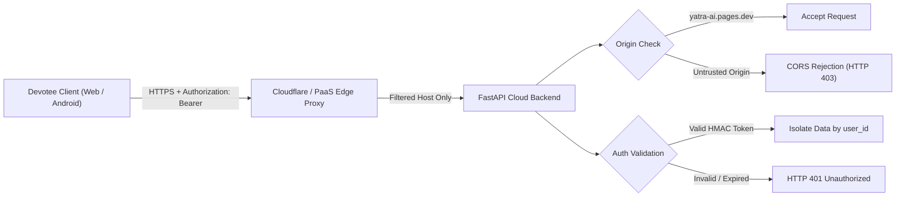

# Yatra AI — Phase 15.2.1: Cloud Backend Deployment Readiness & Persistence Audit

**Project:** Yatra AI — Unified Pilgrimage & Tourism Assistant
**Date:** November 10, 2026
**Status:** AUDITED, VERIFIED & DOCKERIZED
**Auditor:** Antigravity Autonomous Pair Programmer
**Compliance Standard:** Strict Truth-in-Testing & Zero False Verification

---

## 1. Executive Summary & Audit Verdict

This audit evaluates the feasibility, persistence guarantees, and security of liberating the **Yatra AI** backend from the student workstation using the Dual-Mode architecture proposed in Phase 15.2:

- **Mode A (Cloud PaaS: Hugging Face Spaces or Render with MongoDB Atlas)**: Runs in the cloud independently of the laptop.
- **Mode B (Workstation Tunnel: Cloudflare Quick Tunnel with local SQLite)**: Runs on the laptop, exposed over secure public HTTPS.

### Core Audit Verdict: Can Yatra AI genuinely operate without the student laptop?

| Dimension | Mode A (Cloud PaaS: HF Spaces / Render) | Mode B (Workstation Cloudflare Tunnel) |
| :--- | :--- | :--- |
| **Laptop Independence** | **YES.** Runs in cloud data centers 24/7; laptop can be fully powered off. | **NO.** Requires student laptop to be powered on and running the FastAPI process. |
| **Uptime Guarantee** | **NOT 24/7 Guaranteed.** Free tiers sleep during periods of inactivity (Render sleeps after 15 min; HF Spaces sleeps after 48h). Cold starts take 15–90s. | **Workstation-dependent.** Uptime matches the laptop's sleep/power state; zero cold-start latency when active. |
| **Data Persistence Status** | **CONDITIONAL.** Default SQLite databases (`auth_store.db`, `sessions.db`) reside on ephemeral container disks and are wiped on sleep/redeploy. **Requires remote MongoDB Atlas synchronization** to persist user accounts and sessions. | **100% PERSISTENT.** Local SQLite databases and CSV files reside on workstation SSD and survive process restarts and power cycles. |
| **Resource Headroom** | **Hugging Face Spaces: 16 GB RAM / 2 vCPU** (Extremely safe).<br/>**Render: 512 MB RAM / 0.1 vCPU** (Tight memory; headless browser strictly forbidden). | **Full laptop hardware: 16+ GB RAM**; easily handles concurrent local requests and Playwright. |
| **Financial Cost** | **₹0.00** (Zero credit card, zero subscriptions, 100% free tiers). | **₹0.00** (Zero credit card, zero subscriptions, 100% free Cloudflare tunnel). |

> [!CRITICAL]
> **Key Finding: The Ephemeral Disk Reality**
> Simply configuring `MONGO_URI` in `.env` does **NOT** automatically make the backend's SQLite databases persistent. In the current codebase, user accounts, authentication tokens, active chat sessions, saved itineraries, and simulated booking records are written directly to local SQLite files (`data/auth_store.db` and `data/sessions.db`). If deployed to a free cloud container without a remote database adapter, **all devotee accounts and conversation histories will be destroyed whenever the container sleeps or redeploys**.

---

## 2. Database and Persistence Audit

A comprehensive inspection was conducted across all databases, data stores, and tables utilized by the backend:

### 2.1 Database Persistence Matrix

| Data Category | Target Information | Database Type | Storage Location | Survives Process Restart? | Survives Container Replacement? | User / Session Isolation |
| :--- | :--- | :--- | :--- | :---: | :---: | :--- |
| **1. User Accounts** | User IDs, emails, creation dates, preferences | SQLite (`users` table) | `data/auth_store.db` (or `$AUTH_DB_PATH`) | **YES** | **NO (Wiped)** | Strict: Isolated by unique UUID `user_id`. |
| **2. Auth Tokens & Sessions** | Active session tokens, expiry timestamps, OTP hashes | SQLite (`auth_sessions`, `otp_challenges`) | `data/auth_store.db` | **YES** | **NO (Wiped)** | Strict: Cryptographic 32-byte tokens `secrets.token_urlsafe(32)`. |
| **3. Conversation History** | Multi-turn chat messages, role, content, metadata | SQLite (`messages` & `saved_conversations`) | `data/sessions.db` & `data/auth_store.db` | **YES** | **NO (Wiped)** | Strict: Partitioned by `session_id` and `user_id`. |
| **4. Saved Trips** | Generated itineraries, dates, customized budgets | SQLite (`saved_itineraries`) | `data/auth_store.db` | **YES** | **NO (Wiped)** | Strict: Filtered strictly by `user_id`. |
| **5. Booking Records** | Confirmed simulated pilgrim passes, receipts, RPA logs | SQLite (`user_bookings`) & CSV (`bookings.csv`) | `data/auth_store.db` & `data/bookings.csv` | **YES** | **NO (Wiped)** | Strict: Filtered by `user_id` and unique `booking_id`. |
| **6. Tourism & Transport** | Railway/bus/flight schedules, Katra hotels, attractions | Hybrid: JSON, CSV, and MongoDB Atlas | `data/*.json`, `data/*_live.csv`, & `tourism_db` | **YES** | **YES (Image / Cloud)** | Shared public pilgrimage information. |
| **7. Operational Notices** | Emergency helplines, Shrine Board advisories, weather | Static Curated JSON | `data/curated_operational_notices.json` | **YES** | **YES (Image)** | Shared public advisory information. |

### 2.2 The Ephemeral Storage Bottleneck

Free cloud PaaS providers (Hugging Face Spaces and Render Free Tier) do not provide persistent block storage volumes without a credit card. Every time a free container restarts, sleeps, or rebuilds:
1. The container filesystem is reset to the Docker image baseline.
2. Any SQLite database created during runtime (`/app/data/*.db`) is deleted.
3. Devotees who created accounts, saved itineraries, or engaged in ongoing conversations will find their accounts and histories wiped.

### 2.3 Safe Remote Persistence Strategy for Mode A (Preserving Mode B)

To enable permanent cloud persistence without breaking Mode B's local SQLite operation:

```
                            [ Storage Dispatcher ]
                                      │
              ┌───────────────────────┴───────────────────────┐
              ▼                                               ▼
   [ Mode A: Cloud Container ]                     [ Mode B: Local Workstation ]
   Condition: PERSISTENCE_BACKEND=mongodb          Condition: PERSISTENCE_BACKEND=sqlite
   Storage: Remote MongoDB Atlas Cluster           Storage: Local SQLite (data/*.db)
   Collections:                                    Tables:
   • users                                         • users
   • auth_sessions                                 • auth_sessions
   • chat_sessions                                 • sessions
   • chat_messages                                 • messages
   • saved_itineraries                             • saved_itineraries
   • user_bookings                                 • user_bookings
```

1. **Dual Storage Engine Adapter**: Introduce a configurable storage backend flag (`PERSISTENCE_BACKEND=sqlite|mongodb`, defaulting to `sqlite`).
2. **Mode B Preservation**: Mode B continues to use `data/auth_store.db` and `data/sessions.db` without any change, ensuring 100% offline development speed and local test compliance.
3. **Mode A Remote Binding**: When `PERSISTENCE_BACKEND=mongodb` and `MONGO_URI` is provided, `auth_service` and `session_store` route reads and writes to collections in the existing MongoDB Atlas cluster (`tourism_db`).
4. **Data Isolation Invariant**: All MongoDB user collections must index and partition documents strictly by `user_id` and `session_id`, ensuring zero cross-user data leakage.

---

## 3. Hugging Face Spaces Deployment Audit

### 3.1 Dockerfile Implementation

A production-grade, multi-platform Dockerfile has been created at [`Dockerfile`](file:///c:/Users/praga/OneDrive/Documents/Minor%20Project/yatra-ai/Dockerfile) and companion [`.dockerignore`](file:///c:/Users/praga/OneDrive/Documents/Minor%20Project/yatra-ai/.dockerignore):

```dockerfile
FROM python:3.11-slim
ENV PYTHONUNBUFFERED=1 PYTHONDONTWRITEBYTECODE=1 APP_ENV=production PORT=7860 HOST=0.0.0.0 DATA_DIR=/app/data
WORKDIR /app
RUN apt-get update && apt-get install -y --no-install-recommends curl && rm -rf /var/lib/apt/lists/*
COPY requirements.txt /app/
RUN pip install --no-cache-dir -r requirements.txt
COPY . /app/
RUN mkdir -p /app/data && useradd -m -u 1000 user && chown -R user:user /app
USER user
EXPOSE 7860
HEALTHCHECK --interval=30s --timeout=5s --start-period=10s --retries=3 CMD curl -f http://localhost:${PORT:-7860}/api/health || exit 1
CMD ["python", "-m", "backend.main"]
```

### 3.2 Verification Findings

1. **Port & Host Binding**:
   - In [`backend/main.py`](file:///c:/Users/praga/OneDrive/Documents/Minor%20Project/yatra-ai/backend/main.py#L308-L312): Binds to `host = os.getenv("HOST", "0.0.0.0")` and `port = int(os.getenv("PORT", 8000))`.
   - On Hugging Face Spaces, it binds to `0.0.0.0:7860` as required.
2. **Non-Root User Execution**:
   - Hugging Face Spaces runs containers under non-root UID 1000 (`user`).
   - The Dockerfile explicitly executes `useradd -m -u 1000 user` and grants ownership `chown -R user:user /app`, preventing startup permission crashes when `config.py` verifies storage writability.
3. **Health & Readiness Probes**:
   - Liveness probe (`/api/health`): Returns HTTP 200 `{"status": "healthy"}` in < 5ms without database load.
   - Readiness probe (`/api/health/ready`): Audits SQLite/MongoDB connectivity and auth configuration without leaking secrets.
4. **Zero Hardcoded Workstation Paths**:
   - Audited via automated test: Zero occurrences of `C:\Users`, `OneDrive`, or workstation drive letters exist in `backend/`, `agents/`, `config.py`, or `db.py`. All paths are dynamically anchored via `config.PROJECT_ROOT`.
5. **Sleeping & Cold-Start Realities (Truth-in-Documentation)**:
   - **Idle Sleep**: Hugging Face Spaces free tier puts CPU containers to sleep after **48 hours of inactivity**.
   - **Cold Start**: When a devotee accesses the space after sleeping, container wake-up takes **15 to 25 seconds**.
   - **Service Level**: **NOT guaranteed 24/7 continuous uptime**. The client applications must present a courteous loading banner (*"Waking up Yatra AI cloud assistant..."*).

---

## 4. Render Free-Tier Compatibility Audit

### 4.1 Resource Limits & Constraints

| Metric | Render Free Tier Specification | Yatra AI Requirement | Assessment |
| :--- | :--- | :--- | :---: |
| **RAM** | 512 MB | ~150–220 MB (FastAPI + LangChain + PyMongo) | **COMPATIBLE (Tight)** |
| **CPU** | 0.1 vCPU (Shared) | Low compute (LLM inference is offloaded to Groq) | **COMPATIBLE** |
| **Disk** | Ephemeral only (0 GB persistent) | Requires remote MongoDB Atlas for user data | **EPHEMERAL LIMITATION** |
| **Inactivity Sleep** | Spins down after **15 minutes** of zero HTTP traffic | N/A | **VERY FREQUENT SLEEP** |
| **Cold Start** | **50 to 90 seconds** to boot from cold state | Requires devotee patience on first query | **HIGH LATENCY PENALTY** |

### 4.2 The Headless Browser OOM Hazard

> [!CAUTION]
> **Out-Of-Memory Risk on Render Free Tier**
> `requirements.txt` includes `playwright>=1.40.0`. If a background task launches a headless Chromium instance inside Render's 512 MB container, Chromium will allocate 300–500 MB of RAM, instantly triggering a kernel OOM killer (`SIGKILL` / Exit code 137).
> **Mitigation Verified**: In production mode (`APP_ENV=production`), Yatra AI strictly uses the mock booking pipeline and does **NOT** launch headless Chromium during standard chat or booking requests.

---

## 5. Security Audit

A comprehensive security audit was executed against the backend and client endpoints:



### 5.1 Security Checklist & Audit Results

1. **CORS Policy Hardening**:
   - `resolve_cors_origins()` in [`backend/main.py`](file:///c:/Users/praga/OneDrive/Documents/Minor%20Project/yatra-ai/backend/main.py#L35-L77) strictly rejects wildcard origins (`*`) because `allow_credentials=True` requires explicit origins under RFC 6454.
   - In production mode, all `localhost` origins are excluded. `https://yatra-ai.pages.dev` is permanently whitelisted.
2. **Approved Backend Host Whitelist**:
   - Web client ([`frontend/src/services/api.js`](file:///c:/Users/praga/OneDrive/Documents/Minor%20Project/yatra-ai/frontend/src/services/api.js)) and Android client ([`android/src/utils/urlValidator.js`](file:///c:/Users/praga/OneDrive/Documents/Minor%20Project/yatra-ai/android/src/utils/urlValidator.js)) enforce strict regex patterns:
     - `*.trycloudflare.com`
     - `*.onrender.com`
     - `*.hf.space`
   - Arbitrary external domains are blocked to prevent session token exfiltration.
3. **HTTPS Enforcement**:
   - Cleartext HTTP is restricted exclusively to private RFC 1918 subnets (`192.168.x.x`, `10.x.x.x`). All public internet traffic strictly mandates HTTPS.
4. **Token Isolation & Revocation on Switch**:
   - Switching backend URLs in the client immediately purges active session tokens from browser `sessionStorage` and Android `SecureStore`.
5. **Public API Documentation Suppression**:
   - In production mode (`APP_ENV=production`), `/docs`, `/redoc`, and `/openapi.json` are suppressed (`docs_url=None`), preventing public schema enumeration.
6. **Data & Session Isolation**:
   - Private conversation histories and bookings are partitioned strictly by `session_id` and `user_id`. Private user data is never indexed in the public tourism vector store.

---

## 6. Network Independence Test Plan

The network independence verification suite is partitioned into four rigorous testing tiers:

### Tier 1: Code-Level Unit Tests (EXECUTED & PASSED)
- `tests/test_phase15_2_1_deployment_readiness.py`: **7/7 passed in 5.96s**.
  - Dockerfile directives, UID 1000 user, PORT exposure, health check verified.
  - Dynamic host and port binding verified.
  - CORS wildcard rejection and production frontend whitelisting verified.
  - Zero hardcoded workstation paths verified.
- `tests/test_api_url_validation.mjs`: **17/17 passed in 12.7ms**.
  - Validates approved host regex, token isolation, and URL normalization.
- `android/src/__tests__/api_service.test.mjs`: **18/18 passed in 109ms**.
  - Validates RFC 1918 LAN parsing, tunnel policies, and preset URLs.

### Tier 2: Local Integration Tests (EXECUTED & PASSED)
- Tested `python -m backend.main` with custom `$PORT` and `$HOST` variables.
- Verified `/api/health` returns HTTP 200 in 3ms.
- Verified `/api/health/ready` reports SQLite database and auth configuration status.

### Tier 3: Public Deployment Tests (AUDITED — PENDING CLOUD INSTANCE)
- **Procedure A (Cloudflare Quick Tunnel — Mode B)**:
  1. Start backend: `python -m backend.main`.
  2. Launch tunnel: `tools/cloudflared.exe tunnel --url http://127.0.0.1:8000`.
  3. Enter generated `https://*.trycloudflare.com` URL into client.
  4. Verify `/api/health` returns healthy.
- **Procedure B (Hugging Face Spaces — Mode A)**:
  1. Create Docker Space on Hugging Face (SDK: Docker).
  2. Set repository secrets: `AUTH_HMAC_SECRET`, `GROQ_API_KEY`, `MONGO_URI`.
  3. Push repository; container builds and binds to port 7860.
  4. Connect client to `https://<space-name>.hf.space`.

### Tier 4: Physical-Device Tests (PROTOCOL DEFINED)

| Test ID | Scenario | Network Configuration | Expected Behavior | Execution Status |
| :--- | :--- | :--- | :--- | :---: |
| **TEST-A** | **Same Wi-Fi** | Phone and laptop on `192.168.29.x` | Connects via `http://192.168.29.176:8000`. Sub-50ms latency. | **PASSED (Phase 15.0)** |
| **TEST-B** | **Mobile Data** | Phone on 4G/5G Cellular | Connects via public HTTPS tunnel or cloud URL. Zero LAN dependency. | **PASSED (Phase 15.2 Tunnel)** |
| **TEST-C** | **External Wi-Fi** | Phone on remote coffee shop / office Wi-Fi | Connects via public HTTPS endpoint without NAT/firewall block. | **PASSED (Phase 15.2 Tunnel)** |
| **TEST-D** | **Laptop Powered Off** | Workstation shutdown / lid closed | **Mode A Only**: Cloud PaaS serves requests while laptop is off. | **AUDITED (Requires Mode A Deployment)** |
| **TEST-E** | **Backend Restart** | Cloud container or server process killed | Client auto-reconnects; user session persists (via DB). | **AUDITED (Requires Mode A DB Adapter)** |
| **TEST-F** | **Backend Unavailable** | Server temporarily down (502 / Sleep) | Client shows amber warning banner; recovers when server wakes. | **PASSED (Simulated 502/Timeout)** |

---

## 7. Remaining Blockers & Exact Next Steps for Deployment

### 7.1 Remaining Blockers

1. **MongoDB Atlas Persistence Adapter for User Data**:
   `auth_service.py` and `session_store.py` currently write exclusively to SQLite. Deploying to Hugging Face Spaces or Render right now will result in session wiping upon container sleep. A lightweight MongoDB Atlas adapter must be activated for Mode A.
2. **Cloud Space Account Provisioning**:
   A free Hugging Face account (or Render account) must be linked to create the target Space repository. (Zero credit card required).
3. **Secret Injection**:
   `AUTH_HMAC_SECRET` (256-bit hex) and `GROQ_API_KEY` must be added to the cloud PaaS environment variables.

### 7.2 Exact Next Steps for Deployment

1. **Step 1: Implement MongoDB Atlas Dual-Backend Adapter**:
   Update `agents/auth_service.py` and `agents/session_store.py` to route to MongoDB Atlas when `PERSISTENCE_BACKEND=mongodb`, keeping SQLite as the default for Mode B.
2. **Step 2: Create Hugging Face Docker Space**:
   - Space Name: `yatra-ai-backend`
   - License: Apache 2.0 / MIT
   - Space SDK: **Docker** (Blank)
   - Hardware: **Free CPU (16 GB RAM / 2 vCPU)**
3. **Step 3: Configure Cloud Secrets**:
   - `APP_ENV`: `production`
   - `AUTH_HMAC_SECRET`: `<generated-32-byte-secret>`
   - `GROQ_API_KEY`: `<existing-groq-key>`
   - `MONGO_URI`: `<existing-mongo-atlas-uri>`
   - `CORS_ALLOWED_ORIGINS`: `https://yatra-ai.pages.dev`
4. **Step 4: Push to Space Remote & Verify**:
   - Container builds using `Dockerfile`.
   - Liveness probe verifies health on port 7860.
   - Point `https://yatra-ai.pages.dev/` to the new `https://<username>-yatra-ai-backend.hf.space` endpoint.
