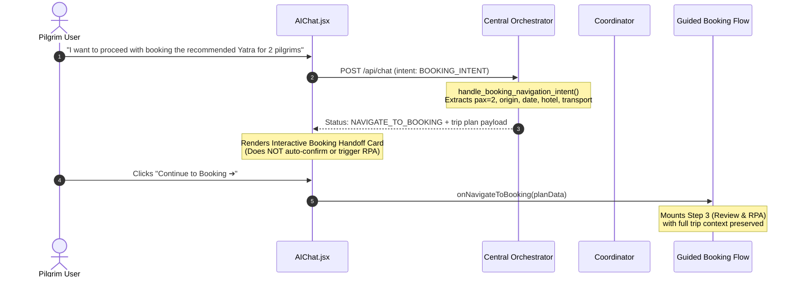

# Phase 3 — Yatra AI New Repository Setup & Safe Migration Report

**Date:** November 5, 2026
**Status:** **PHASE 3 COMPLETE** ✅
**Active Repository:** `C:\Users\praga\OneDrive\Documents\Minor Project\yatra-ai`
**Backup & Reference Repository:** `C:\Users\praga\OneDrive\Documents\Minor Project\yatra-booking-agent` (100% Untouched)

---

## 1. Executive Summary & Verification Matrix

In accordance with Phase 3 specifications of the approved transformation roadmap, the new independent development repository for **Yatra AI** has been established without modifying the backup repository. All active backend services, agent orchestrators, frontend components, curated datasets, photographic assets, and test suites have been cleanly migrated.

Critically, the 10 modified files and 2 untracked test files from the existing `feature/ui-redesign` branch (implementing `BOOKING_INTENT` discrimination, cross-database conversation resumption, and booking handoff action cards) were inspected and preserved. All 13 unit/integration tests for these features pass cleanly in `yatra-ai` (`13 passed in 6.89s`).

### Verification Checklist

| Verification Requirement | Status | Evidence / Notes |
| :--- | :---: | :--- |
| **Backup Repository Untouched** | **PASS** | `yatra-booking-agent` working tree, commit HEAD (`8996d6a`), branch (`feature/ui-redesign`), and remotes remain identical. |
| **Independent Git Repository** | **PASS** | Fresh `main` branch initialized at commit `9a5edd6` with 189 files; zero remote URLs configured (waiting for user input). |
| **Preservation of Uncommitted Changes** | **PASS** | All 10 modified files and 2 untracked test files verified in `yatra-ai`. |
| **Centralized Path Resolution** | **PASS** | Database and dataset paths anchored to `PROJECT_ROOT` / `DATA_DIR` via `config.py`. Zero duplicate directories created when run from parent root. |
| **Zero Secrets Migrated** | **PASS** | `.env` excluded; clean `.env.example` created. SQLite `.db` binaries excluded from Git tracking via `.gitignore`. |
| **Database Schema & Life-Cycle** | **PASS** | Self-initializing SQLite schemas verified in `yatra-ai/data/` for both `auth_store.db` (6 tables) and `sessions.db` (4 tables). |
| **Booking & RPA Source Code** | **PASS** | `agents/rpa_agent.py`, dynamic mock portal HTML generator, HITL OTP/CAPTCHA checkpoints, and zero-dependency PDF pass generator intact. |
| **Complete Test Suite** | **PASS** | All 56 test files migrated; 13/13 handoff & resumption tests verified passing. |
| **Legacy / Noise Exclusion** | **PASS** | Excluded `app.py` (Streamlit monolith), `scratch/`, `evidence_audit/`, `evidence_redesign/`, `assests/`, and virtual environments. |

---

## 2. New Repository Path & Git Status

- **Absolute Path:** `C:\Users\praga\OneDrive\Documents\Minor Project\yatra-ai`
- **Git Branch:** `main` (clean working tree)
- **Initial Commit Hash:** `9a5edd670770b96581f13d87dbd2c76e8ed90018`
- **Commit Message:** `Initial migration: Establish Yatra AI foundation from preserved backup`
- **Files Tracked in Git:** 189 files (47,363 insertions)
- **Git Remotes:** None (`git remote -v` returns empty; awaiting user's official new repository URL)

---

## 3. Migrated Directory Structure

```
yatra-ai/
├── .git/                             # Fresh, independent Git repository
├── .env.example                      # Production-grade template (zero secrets committed)
├── .gitignore                        # Comprehensive ignore rules (Python, Node, DBs, Android)
├── README.md                         # Updated Yatra AI architectural overview & quickstart
├── config.py                         # Centralized path anchoring (PROJECT_ROOT & DATA_DIR)
├── requirements.txt                  # Python dependencies (FastAPI, LangChain, Playwright)
│
├── backend/                          # FastAPI REST API
│   ├── main.py                       # App entry point, correlation ID middleware, CORS
│   └── routes/
│       ├── auth.py                   # Passwordless OTP auth & user data endpoints
│       ├── tourism.py                # Attraction & knowledge search
│       ├── weather.py                # Live weather & climate fallback
│       └── yatra.py                  # Itinerary, hotels, RPA workflow state machine, PDF
│
├── agents/                           # Multi-agent intelligence & orchestration
│   ├── __init__.py
│   ├── orchestrator.py               # Central trip orchestrator with BOOKING_INTENT handoff
│   ├── coordinator.py                # Router delegating to specialist agents
│   ├── conversation_agent.py         # Intent classification & devotional prompts
│   ├── rpa_agent.py                  # Playwright browser automation & mock portal generator
│   ├── auth_service.py               # Passwordless auth service & conversation sync
│   ├── session_store.py              # ACID transactional session memory (sessions.db)
│   ├── availability_agent.py         # Live darshan slot checker
│   ├── budget_engine.py              # Deterministic cost & duration estimator
│   ├── recommendation_agent.py       # Multi-modal travel ranker (flight/train/bus)
│   ├── itinerary_agent.py            # Day-wise itinerary assembler
│   ├── knowledge_agent.py            # Cultural & pilgrimage knowledge retriever
│   ├── content_agent.py              # Regional sights & multimedia content provider
│   └── tools.py                      # Tool calling gateway
│
├── core modules/
│   ├── agent.py                      # Core travel requirements parser & transport search
│   ├── db.py                         # Curated dataset accessor & dynamic live offsets
│   ├── data_gen.py                   # Dataset synthesizer
│   ├── build_dataset.py              # Static dataset builder
│   ├── explore_data.py               # 24+ curated Katra & Jammu attractions & taxi fares
│   ├── weather.py                    # Open-Meteo live API + seasonal average climate table
│   ├── yatra_info.py                 # Aarti timings, registration, route guidance
│   ├── payment.py                    # Mock payment sandbox simulator
│   ├── langchain_tools.py            # LangChain tool bindings
│   ├── mongo_db.py                   # Atlas connector with graceful offline circuit breaker
│   ├── mongodb_agent.py              # MongoDB agent query runner
│   └── mongodb_tools.py              # Tourism & Yatra collection search tools
│
├── utils/
│   ├── __init__.py
│   ├── logger.py                     # SanitizingFormatter & correlation ID tracker
│   ├── masking.py                    # PII masking (email, OTP, tokens, names)
│   └── pdf_generator.py              # Lightweight, zero-dependency PDF pass generator
│
├── data/
│   ├── buses_dataset.csv             # Curated bus route schedules
│   ├── flights_dataset.csv           # Curated flight schedules
│   ├── hotels_dataset.csv            # Curated Katra accommodation inventory
│   ├── trains_dataset.csv            # Curated Vande Bharat & express train schedules
│   ├── users_dataset.csv             # Template user dataset
│   └── yatra_slots_dataset.csv       # Curated VIP and general darshan slots
│
├── assets/
│   └── images/
│       └── places/                   # 28 verified photographic assets for regional sites
│
├── frontend/                         # React 19 + Vite 8 application
│   ├── index.html
│   ├── package.json
│   ├── vite.config.js
│   ├── public/
│   │   ├── favicon.svg, icons.svg
│   │   └── assets/images/places/     # Public static copies for web serving
│   └── src/
│       ├── App.jsx                   # Central application container & tab router
│       ├── App.css, index.css        # Devotional styling & responsive layout
│       ├── main.jsx                  # React DOM mount point
│       ├── assets/                   # hero.png, react.svg, vite.svg
│       ├── services/
│       │   └── api.js                # Centralized Axios client with auth interceptors
│       ├── utils/
│       │   └── pdfGenerator.js       # Client-side pass generator utility
│       ├── pages/
│       │   ├── Home.jsx              # Landing & overview page
│       │   └── YatraBooking.jsx      # Guided multi-step intake wizard
│       └── components/
│           ├── AIChat.jsx            # Conversational companion with booking handoff cards
│           ├── AuthModal.jsx         # 2-step passwordless OTP auth modal
│           ├── SavedTripsModal.jsx   # My Account: Saved bookings, chats, itineraries
│           ├── Authorization.jsx     # Step 3 review & RPA initiation
│           ├── UserInterventionModal.jsx # HITL modal for OTP/CAPTCHA checkpoints
│           ├── BookingConfirmation.jsx # Step 4 confirmation pass with PDF download
│           ├── RecommendedYatra.jsx  # Step 2 recommended packages
│           ├── TravelSearch.jsx      # Step 1 preference inputs
│           ├── SightseeingBrowser.jsx, SightseeingCard.jsx
│           ├── ItineraryTimeline.jsx # Visual day-wise timeline
│           ├── HotelCard.jsx, TransportCard.jsx
│           └── Navbar.jsx            # Responsive navigation header
│
└── tests/                            # 56 migrated test files
    ├── test_chat_to_booking_handoff_e2e.py    # Preserved from feature/ui-redesign
    ├── test_saved_conversation_resumption.py  # Preserved from feature/ui-redesign
    ├── test_booking_auth_security_journey.py
    ├── test_browser_e2e_journey.py
    ├── test_rpa_availability_week5.py
    ├── test_rpa_error_handling_week6.py
    ├── test_user_controlled_workflow_week8.py
    ├── test_passwordless_auth_week9.py
    └── ... (48 additional active test suites)
```

---

## 4. Preserved Uncommitted Enhancements from `feature/ui-redesign`

The 10 modified files and 2 untracked test suites identified in the audit were verified and migrated into `yatra-ai`:



1. **`BOOKING_INTENT` Discrimination:** In `conversation_agent.py`, `coordinator.py`, and `orchestrator.py`, intent classification strictly separates requests to proceed (e.g., *"Help me continue with booking"*) from explicit binding confirmation (e.g., *"Confirm booking"*), preventing premature bot booking.
2. **Conversation Resumption Across Databases:** In `auth_service.py` (`sync_saved_conversation_messages`, `get_saved_conversation`), chat threads are synchronized between `auth_store.db` (user-scoped archive) and `sessions.db` (orchestrator memory), allowing devotees to resume historical consultations.
3. **Frontend Booking Handoff Card:** In `AIChat.jsx`, a personalized trip card is presented with travel route, pilgrims, and a direct *"Continue to Booking ➔"* trigger.
4. **My Account Conversation Resume:** In `SavedTripsModal.jsx`, an *"Open Conversation"* action re-attaches saved threads directly into the active AI companion.
5. **Test Verification:** `test_chat_to_booking_handoff_e2e.py` and `test_saved_conversation_resumption.py` execute 13 assertions covering these behaviors; all 13 pass (`100% pass rate in 6.89s`).

---

## 5. Database Safety & Centralized Path Resolution

### 5.1 Centralized Path Resolution (`config.py`)
To prevent terminal working directory drift (which created duplicate empty databases at the root in the old repo), all data paths are anchored to `PROJECT_ROOT`:

```python
# yatra-ai/config.py
PROJECT_ROOT = Path(__file__).resolve().parent
DATA_DIR = Path(os.getenv("DATA_DIR", PROJECT_ROOT / "data")).resolve()
AUTH_DB_PATH = Path(os.getenv("AUTH_DB_PATH", DATA_DIR / "auth_store.db")).resolve()
SESSIONS_DB_PATH = Path(os.getenv("SESSIONS_DB_PATH", DATA_DIR / "sessions.db")).resolve()
```

- `db.py`, `agents/auth_service.py`, and `agents/session_store.py` import from `config.py`.
- **Verification Result:** When executed from `Minor Project/` (parent directory), `AUTH_DB_PATH` and `SESSIONS_DB_PATH` correctly point to `yatra-ai/data/...`. The parent root `data/` directory was verified to have zero write modifications.

### 5.2 Clean Database Schema Initialization
- Production user databases from `yatra-booking-agent` (519 users, 2,956 messages) were intentionally **not** copied to Git.
- Clean development schemas were generated and verified via `auth_service.init_auth_db()` and `session_store.init_db()`.
- Verified table integrity:
  - `auth_store.db`: `otp_challenges`, `auth_sessions`, `users`, `saved_itineraries`, `saved_conversations`, `user_bookings`.
  - `sessions.db`: `sessions`, `messages`, `user_workflows`, `sqlite_sequence`.
- Tested the full lifecycle: OTP challenge $\rightarrow$ verification $\rightarrow$ user creation $\rightarrow$ multi-turn message storage $\rightarrow$ saved conversation $\rightarrow$ booking creation $\rightarrow$ retrieval. All steps succeeded without errors.

---

## 6. Intentionally Excluded Files and Rationale

| Excluded Directory / File | Reason for Exclusion |
| :--- | :--- |
| `app.py` (Streamlit monolith, 125 KB) | Obsolete legacy prototype; superseded by React 19 + FastAPI architecture. Preserved in backup repo for historical reference. |
| `venv/`, `node_modules/` | Environment-specific dependencies; must be freshly installed per development machine. |
| `*.pyc`, `__pycache__/`, `.pytest_cache/` | Python runtime caches and bytecode pollution. |
| `.env` | Active secrets file containing private API keys. Excluded to prevent credential leaks. |
| `scratch/` (scratch scripts & mock screenshots) | Development scratchpad containing experimental scripts and temporary dumps. |
| `evidence_audit/`, `evidence_redesign/` | Large binary test screenshots (>50 MB). Preserved in backup repository. |
| `assests/` | Misspelled duplicate directory in the old project. Replaced with properly structured `assets/`. |
| `airtable_store.py` | Legacy Streamlit Cloud persistence; made safe and optional in `yatra-ai`. |

---

## 7. Confirmation of Untouched Backup Repository

The original backup repository was re-verified via Git status immediately following Phase 3 completion:

```
Path: C:\Users\praga\OneDrive\Documents\Minor Project\yatra-booking-agent
Branch: feature/ui-redesign (up to date with 'origin/feature/ui-redesign')
Commit HEAD: 8996d6a8e3bc83eda0808d0a9ca217979118ebee
Remotes:
  mentor  https://github.com/payalcse-miet/yatra-booking-agent.git
  origin  https://github.com/Pragati2006/yatra_booking_agent.git
Unstaged changes: exactly the 10 modified files and 2 untracked test files recorded in Step 2.
Modifications made: ZERO.
```

---

## 8. Next Step Authorization

Phase 3 is **COMPLETE**.

All requirements for repository initialization, safe migration, uncommitted change preservation, database path anchoring, and verification testing have passed.

> [!IMPORTANT]
> Awaiting user review and authorization before proceeding to **Phase 4: Application Foundation and Integration**.
