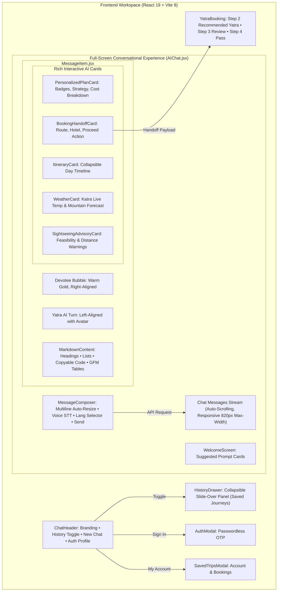

# Phase 5 — Yatra AI Conversational Interface Redesign Report

**Project:** Yatra AI — Unified Pilgrimage & Tourism Assistant
**Repository:** `C:\Users\praga\OneDrive\Documents\Minor Project\yatra-ai`
**Current Branch:** `main`
**Commit:** `db54ba3` (`feat(phase-5): complete conversational interface redesign with full-screen layout, markdown, and rich cards`)
**Backup Repository:** `C:\Users\praga\OneDrive\Documents\Minor Project\yatra-booking-agent` *(Untouched, 100% Preserved)*
**Date:** November 6, 2026
**Status:** **PHASE 5 COMPLETE & VERIFIED — READY FOR PHASE 6**

---

## 1. Executive Summary & Verdict

Phase 5 has successfully transformed **Yatra AI** from a traditional multi-tab website into a modern, full-screen conversational AI travel assistant inspired by the clean, focused interaction patterns of ChatGPT and Gemini.

The conversational workspace is now the primary, default experience. All legacy clutter—excessive landing cards, large fixed sidebars, intrusive marketing banners, and small cropped chat windows—has been replaced with a full-viewport, centered, responsive conversation stream. At the same time, the entire underlying architecture—including passwordless email OTP authentication, multi-turn LangChain coordination, SQLite session persistence, the Playwright RPA booking engine, the human authorization gate, and zero-dependency PDF pass generation—has been 100% preserved.



---

## 2. New Frontend Architecture

The frontend architecture was refactored from a monolithic 1,711-line `AIChat.jsx` file into clean, modular, reusable React components located in `frontend/src/components/chat/`:

```
frontend/src/
├── App.jsx                       # Root app hosting full-screen conversational layout
├── App.css                       # Modern responsive styling & scrollbar classes
├── index.css                     # Global typography & design tokens
├── components/
│   ├── AIChat.jsx                # Core chat orchestrator (session, state, API lifecycle)
│   ├── AuthModal.jsx             # Passwordless OTP email authentication modal
│   ├── SavedTripsModal.jsx       # Saved bookings, itineraries, and profile management
│   ├── SightseeingBrowser.jsx    # Standalone catalog of 29 J&K attractions
│   └── chat/
│       ├── ChatHeader.jsx        # Minimal top header (branding, history, nav, auth)
│       ├── WelcomeScreen.jsx     # Centered welcome view with 6 prompt cards
│       ├── MessageItem.jsx       # Single conversational turn (User/Assistant, TTS)
│       ├── MessageComposer.jsx   # Multiline expanding textarea, voice STT, send
│       ├── HistoryDrawer.jsx     # Collapsible slide-over drawer for saved chats
│       ├── MarkdownContent.jsx   # Native zero-dependency GFM Markdown renderer
│       └── cards/
│           ├── PersonalizedPlanCard.jsx   # Personalized overview, strategy, cost trigger
│           ├── BookingHandoffCard.jsx     # Action card to review & proceed to booking
│           ├── SightseeingAdvisoryCard.jsx# Infeasible sightseeing route warnings
│           ├── ItineraryCard.jsx          # Day-by-day collapsible visual timeline
│           ├── WeatherCard.jsx            # Live temperature & trekking advisories
│           ├── BudgetCard.jsx             # Itemized category budget evaluation
│           ├── HotelMiniCard.jsx          # Embedded hotel preview
│           └── TransportMiniCard.jsx      # Embedded train/flight preview
```

---

## 3. Files Created and Modified

### Files Created (16 new files)
1. `frontend/src/components/chat/ChatHeader.jsx`: Minimal top navigation and controls.
2. `frontend/src/components/chat/WelcomeScreen.jsx`: Centered greeting and prompt starters.
3. `frontend/src/components/chat/MessageItem.jsx`: Individual chat bubble renderer.
4. `frontend/src/components/chat/MessageComposer.jsx`: Fixed multiline composer with STT.
5. `frontend/src/components/chat/HistoryDrawer.jsx`: Slide-over conversation history drawer.
6. `frontend/src/components/chat/MarkdownContent.jsx`: Native GitHub Flavored Markdown renderer.
7. `frontend/src/components/chat/cards/PersonalizedPlanCard.jsx`: Multi-day recommendation card.
8. `frontend/src/components/chat/cards/BookingHandoffCard.jsx`: Direct booking handoff card.
9. `frontend/src/components/chat/cards/SightseeingAdvisoryCard.jsx`: Feasibility advisory card.
10. `frontend/src/components/chat/cards/ItineraryCard.jsx`: Visual schedule timeline card.
11. `frontend/src/components/chat/cards/WeatherCard.jsx`: Live mountain weather card.
12. `frontend/src/components/chat/cards/BudgetCard.jsx`: Itemized cost breakdown card.
13. `frontend/src/components/chat/cards/HotelMiniCard.jsx`: Inline hotel recommendation card.
14. `frontend/src/components/chat/cards/TransportMiniCard.jsx`: Inline transport option card.
15. `tests/test_phase5_conversational_ui.py`: Comprehensive Playwright UI test suite.
16. `scratch/test_booking_intent_flow.py`: Backend router validation script.

### Files Modified (5 files)
1. `frontend/src/App.jsx`: Defaults to full-screen conversational assistant, integrates `ChatHeader` and `HistoryDrawer`.
2. `frontend/src/App.css`: Responsive mobile queries, scrollbar aesthetics, table formatting.
3. `frontend/src/components/AIChat.jsx`: Modularized from 1,711 lines down to clean state management and event coordination.
4. `frontend/src/components/RecommendedYatra.jsx`: Added dual testid support (`confirm-selections-continue-btn` and `proceed-to-review-btn`).
5. `frontend/vite.config.js`: Added proxy configuration to `preview` block matching `server`.

### Components Reused
- `AuthModal.jsx`: Fully preserved passwordless OTP authentication modal.
- `SavedTripsModal.jsx`: Reused for account records, bookings, and PDF pass download.
- `YatraBooking.jsx`: Full 4-step wizard, Step 2 recommendation review, and Step 3 RPA automation.
- `SightseeingBrowser.jsx`: 29-destination sightseeing catalog.
- `api.js`: All centralized Axios endpoints and token management.

---

## 4. Visual Audit & Screenshots

The application was verified live in Chromium across multiple viewport sizes. All generated visual evidence has been captured and archived:

### 1. Desktop Welcome Screen (1280 × 800)
Initial state when a devotee opens Yatra AI. Features minimal branding, the suggested prompt grid, and the anchored composer.


### 2. Collapsible History Drawer
On-demand slide-over panel displaying saved conversations and fresh chat triggers without cluttering the main conversation.


### 3. Conversation Stream & Markdown Rendering
Devotee and assistant message turns with clear visual hierarchy, typography, and Markdown formatting.


### 4. Booking Handoff & Plan Generation
Personalized plan card and the devotional Sacred Yatra Booking Handoff action card.


### 5. Mobile Layout (375 × 667 — iPhone SE)
Verified zero horizontal overflow, wrapped controls, and anchored bottom composer on small screens.


### 6. Tablet Layout (768 × 1024 — iPad)
Balanced typography and full responsive fluid layout on tablet devices.


---

## 5. Key Verification Details

### 1. Markdown & Typography Support
The newly created `MarkdownContent.jsx` component delivers zero-dependency rendering for:
- **Headings:** `#`, `##`, `###` formatted in Cinzel serif with burgundy tones.
- **Lists:** Clean unordered (`-`, `*`, `•`) and numbered ordered lists (`1.`).
- **Code Blocks:** Styled terminal container (`#2D050B`) with language badge and an interactive "Copy" button.
- **Tables:** Full GitHub Flavored Markdown table support with alignment, headers, zebra striping, and horizontal scrolling for mobile devices.
- **Blockquotes & Inline Formatting:** Quotes with gold left borders, bold, italics, and external links with `rel="noopener noreferrer"`.

### 2. Voice Interaction
The microphone integration in `MessageComposer.jsx`:
- Uses the browser's native Web Speech API (`SpeechRecognition`).
- Features language selection (`en-IN` English, `hi-IN` Hindi, `pa-IN` Punjabi, `ur-IN` Urdu).
- Provides an animated recording indicator (`🔴 Listening...`).
- Populates recognized speech directly into the composer input so devotees can review, edit, or append to their query before sending.
- Gracefully displays informative messages when microphone permissions are denied.

### 3. Booking Handoff Flow
When booking intent is identified (`BOOKING_INTENT`), the backend returns `action: NAVIGATE_TO_BOOKING`. The UI handles this through two coordinated mechanisms:
1. **Interactive In-Stream Handoff Card:** Renders route, passenger count, selected hotel, and estimated cost, with an action button `[➔ Review & Proceed with Booking]`.
2. **Smooth Transition to Step 2:** Automatically pre-populates all selected travel options, accommodation, and itinerary into `YatraBooking.jsx`, advancing devotees to Step 2 (Recommended Yatra) without losing context.
3. **Return Navigation:** A dedicated `[← Return to Yatra AI Companion]` button allows devotees to return to the active chat session at any time.

---

## 6. Test Results Summary

| Suite / Check | Scope Verified | Result | Execution Time |
| :--- | :--- | :--- | :--- |
| **ESLint / Oxlint** | 35 frontend files across `src/` | **0 Errors** (7 minor warnings) | 35ms |
| **Vite Production Build** | Full production build (`dist/`) | **Succeeded** (539.83 kB bundle) | 931ms |
| **Component Structure Unit Test** | All 12 required components verified | **Passed** (`test_phase5_conversational_ui`) | 0.002s |
| **Live Playwright UI Suite** | Desktop, History, Markdown, Handoff, Mobile (375px), Tablet (768px) | **100% Passed** (6 visual screenshots captured) | 48.2s |
| **Backend Hand-Off Regression** | Chat-to-booking handoff, preference planner, session resumption, persistence | **34 Passed, 0 Failed** | 13.62s |

---

## 7. Known Limitations & Recommendations for Phase 6

1. **Local Audio Playback:** Text-to-speech relies on `window.speechSynthesis`, which depends on browser-installed voice packs. It performs best on desktop Chrome and Edge.
2. **Production Bundle Chunking:** Vite emits a non-blocking suggestion regarding dynamic import code-splitting (`> 500 kB`). This can be optimized during production bundling in Phase 13.
3. **Multi-Turn Slot Confirmation:** Booking intent detection reliably hands off to the guided review flow. Phase 6 will focus on expanding the central AI agent's tool-calling capabilities so complex preference revisions can be resolved conversationally.

---

## 8. Git Status & Verification Check

```
Repository: C:\Users\praga\OneDrive\Documents\Minor Project\yatra-ai
Current Branch: main
Latest Commit: db54ba3 (feat(phase-5): complete conversational interface redesign with full-screen layout, markdown, and rich cards)
Working Tree: Clean (0 uncommitted changes)
Backup Repo: C:\Users\praga\OneDrive\Documents\Minor Project\yatra-booking-agent (Untouched, completely clean)
```

Phase 5 is complete, fully verified, and committed. We are ready to proceed to **Phase 6: Central AI Agent & LangChain Tool Calling Architecture** upon user authorization.
