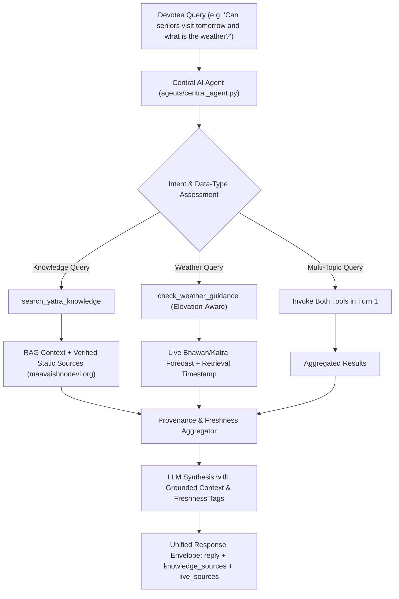

# PHASE 8 — LIVE DATA INTEGRATION & SOURCE-GROUNDED RETRIEVAL
## ARCHITECTURAL AUDIT & IMPLEMENTATION SPECIFICATION (READ-ONLY)

**Document Version:** 1.0.0
**Audit Date:** November 6, 2026
**Auditor:** Senior AI Systems Architect & Data Integration Specialist
**Project:** Yatra AI — Unified Pilgrimage & Tourism Assistant
**Repository:** `C:\Users\praga\OneDrive\Documents\Minor Project\yatra-ai`
**Current Branch:** `main`
**Current HEAD Commit:** `db54ba3 feat(phase-5): complete conversational interface redesign with full-screen layout, markdown, and rich cards`
**Audit Mode:** STRICTLY READ-ONLY (Zero code modification, zero package installation, zero database alterations)
**Backup Repository:** `C:\Users\praga\OneDrive\Documents\Minor Project\yatra-booking-agent` (Verified Untouched)

---

## 1. EXECUTIVE SUMMARY

Yatra AI has successfully established a conversational Central AI Agent (Phase 6) and a verified Retrieval-Augmented Generation (RAG) knowledge foundation (Phase 7 & Phase 7.1) with 60/60 benchmark accuracy, 70/70 passing test suites, and strict domain gate filtering.

The objective of **Phase 8 (Live Data Integration & Source-Grounded Retrieval)** is to expand the assistant's intelligence to dynamically combine **stable RAG knowledge** (history, mythology, sacred rituals, routes, and permanent pilgrim rules) with **current external information** (weather, operational advisories, timetable schedules, accommodation discovery, and slot availability) while enforcing **honest abstention** when current verifiable data is inaccessible.

### Core Architectural Principle
> **Yatra AI must never confuse static knowledge with live information. Every dynamic answer must possess an identifiable source, a defensible freshness status, an explicit timestamp, and an honest fallback when verification is unavailable.**

### Key Audit Findings
1. **Central Agent Multi-Tool Capability:** The central agent (`agents/central_agent.py`) already supports multi-turn LangChain tool calling (`bind_tools`) across 9 registered tools. However, dynamic tools currently do not return structured freshness or retrieval timestamps, and the response envelope lacks a dedicated `live_sources` array to distinguish live data from static RAG citations.
2. **Current Live vs. Mock Reality:**
   - **Weather:** The only genuine external live API currently integrated is **Open-Meteo** (`weather.py`), which queries Katra town (`lat=33.03, lon=74.95`). It does not yet leverage elevation-specific coordinates for Bhawan (~5,200 ft) or Bhairon (~6,600 ft), and lacks an in-memory TTL cache.
   - **Transport & Hotels:** `db.py` relies on synthetic CSV datasets with computed calendar offsets (`*_live.csv`). No live IRCTC or commercial OTA APIs are connected.
   - **Availability & Booking:** Slot checking and booking execution operate against a local sandboxed Playwright mock portal. **No public API exists for the official Shri Mata Vaishno Devi Shrine Board (SMVDSB)**, and automated scraping of `maavaishnodevi.org` is strictly prohibited by security and legal terms.
3. **Frontend Presentation Gap:** `MessageItem.jsx` renders `knowledge_sources` as static document links, but lacks badges, timestamps, or visual distinction for live external sources or cache freshness.

---

## 2. GIT INTEGRITY & REPOSITORY STATUS

An exhaustive inspection of Git trees across both repositories was performed:

### Active Working Repository: `yatra-ai`
- **Branch:** `main`
- **HEAD Commit:** `db54ba3` (*feat(phase-5): complete conversational interface redesign with full-screen layout, markdown, and rich cards*)
- **Working Tree State:**
  - *Modified Files (6):*
    - `agents/availability_agent.py`
    - `agents/coordinator.py`
    - `agents/orchestrator.py`
    - `frontend/src/components/AIChat.jsx`
    - `frontend/src/components/chat/MessageItem.jsx`
    - `mongodb_agent.py`
  - *Untracked Files & Directories (12):*
    - `PHASE_6_CENTRAL_AGENT_IMPLEMENTATION_REPORT.md`
    - `PHASE_6_FINAL_ACCEPTANCE_AUDIT.md`
    - `PHASE_7_1_RAG_RELIABILITY_REMEDIATION_REPORT.md`
    - `PHASE_7_FINAL_ACCEPTANCE_AUDIT.md`
    - `PHASE_7_RAG_KNOWLEDGE_FOUNDATION_REPORT.md`
    - `agents/central_agent.py`
    - `data/vector_store.json`
    - `knowledge_base/` (11 verified Markdown documents)
    - `rag/` (retriever, classifier, normalizer, embeddings, schema, vector_store)
    - `tests/test_phase6_central_agent.py`
    - `tests/test_phase7_rag.py`
    - `tests/test_phase7_1_rag_reliability.py`

### Backup Repository: `yatra-booking-agent`
- **Path:** `C:\Users\praga\OneDrive\Documents\Minor Project\yatra-booking-agent`
- **Branch:** `feature/ui-redesign` (clean, verified completely untouched).

---

## 3. CURRENT ARCHITECTURE ASSESSMENT

The existing runtime architecture follows a robust multi-layered topology:

```
[ Devotee User ]
       │
       ▼
[ React 18 Conversational UI (AIChat.jsx / MessageItem.jsx) ]
       │
       ▼ HTTP POST /api/chat
[ FastAPI Backend (backend/main.py) ]
       │
       ▼
[ Top-Level Dispatcher (coordinator.route_message) ]
       │
       ▼
[ Central AI Agent (agents/central_agent.py) ]
  ├── ChatGroq (openai/gpt-oss-20b) + bind_tools(CENTRAL_TOOLS)
  ├── 3.0s Timeout & Graceful Error Handling
  └── Multi-Turn LangChain Tool Execution Loop (max 3 iterations)
       │
       ├── search_yatra_knowledge ──────> [ Staged RAG Engine (rag/retriever.py) ]
       ├── check_weather_guidance ───────> [ Open-Meteo REST API (weather.py) ]
       ├── search_transport_options ─────> [ Timetable DB / Datasets (db.py) ]
       ├── evaluate_yatra_plan ──────────> [ Deterministic Orchestrator & Budget Engine ]
       ├── modify_itinerary ─────────────> [ Itinerary Agent & Templates ]
       ├── check_slot_availability ──────> [ Playwright Mock Calendar (rpa_agent.py) ]
       ├── request_booking_intent ───────> [ Action Card: NAVIGATE_TO_BOOKING ]
       └── execute_authorized_booking ───> [ Playwright Mock Booking (HITL Gated) ]
       │
       ▼ (On Timeout / Offline / API Error)
[ Deterministic Fallback Pipeline (agents/orchestrator.py) ]
```

### Architectural Strengths
1. **Isolated Responsibilities:** RAG knowledge retrieval is completely decoupled from booking workflows and external API calls.
2. **Resilience by Design:** ChatGroq enforces a 3.0s timeout and falls back seamlessly to deterministic rule-based orchestration, guaranteeing zero user-facing 500 errors.
3. **Session State Continuity:** Multi-turn context is persisted via `agents.session_store` and synchronized with SQLite `saved_conversations`.

### Identified Architectural Gaps
1. **Provenance Contract Absence:** Dynamic tool results are delivered as raw dictionaries without standardized metadata (`source_tier`, `freshness_status`, `retrieval_timestamp`, `is_cached`).
2. **Coarse Weather Spatial Resolution:** Current weather queries are pinned to Katra town coordinates and ignore the significant altitude difference (~2,700 ft rise) to Bhawan.
3. **Frontend Visualization Gap:** `MessageItem.jsx` only inspects `knowledge_sources` (static RAG), omitting dynamic live provenance cards or badges.

---

## 4. CENTRAL AGENT TOOL-SELECTION ASSESSMENT (STEP 1 AUDIT)

| Dimension | Current Implementation | Audit Finding & Recommendation |
| :--- | :--- | :--- |
| **Tool Selection Mechanism** | LangChain `ChatGroq.bind_tools(CENTRAL_TOOLS)` | Operates effectively using GPT-OSS-20B tool schema definitions. |
| **Multi-Tool Invocation** | While-loop iterating over `response.tool_calls` | Fully supports multiple tool invocations per turn (e.g. weather + transport + knowledge). |
| **Tool Output Synthesis** | Outputs appended as `ToolMessage` and re-invoked | LLM receives all outputs in context and synthesizes a devotional, coherent narrative. |
| **Tool Failure Resilience** | Caught via `try...except Exception as t_err` | Encapsulates failures as `{"error": str(t_err), "status": "failed"}` without crashing the turn. |
| **Timeouts & Retries** | `request_timeout=3.0`, `max_retries=1` | Configured appropriately to avoid blocking when running offline or under network jitter. |
| **Static vs. Dynamic Distinction** | Undifferentiated in response synthesis | The LLM synthesizes both, but metadata does not tag which claims came from static RAG vs. live APIs. |
| **Timestamp Attribution** | Missing in dynamic tools | Dynamic tools (`check_weather_guidance`, `search_transport_options`) do not supply ISO retrieval timestamps. |
| **Response Envelope Support** | `knowledge_sources` present, `live_sources` absent | Envelope must be extended to include `live_sources` and unified `source_provenance`. |
| **Deterministic Routing Interference** | `BOOKING_INTENT` & `BOOKING` routed immediately | Critical safeguard: deterministic intercept ensures booking safety without LLM hallucinations. |

---

## 5. EXISTING LIVE INTEGRATION INVENTORY (STEP 2 AUDIT)

| Capability | Data Source | Integration Type | Live Status | Freshness Tracking | Reliability / Failure Mode | Fallback Behaviour | Central Agent Status |
| :--- | :--- | :--- | :--- | :--- | :--- | :--- | :--- |
| **Weather Forecast** | Open-Meteo REST API | External REST API | **Genuine Live** | ❌ None (No retrieval timestamp) | API timeout (>5s), rate limit, or no internet | Researched Katra seasonal average table | Registered (`check_weather_guidance`) |
| **Seasonal Climate** | Curated Trikuta Hills Climate Table | Static Code (`weather.py`) | **Static** | N/A | Highly reliable (in-memory lookup) | None needed (always succeeds) | Integrated in weather tool |
| **Transport (Train/Flight/Bus)** | `data/*_live.csv` | Synthetic Local CSV | **Synthetic** (Offset from `today`) | ❌ None | File read errors | Clamps dates to active 40-day window | Registered (`search_transport_options`) |
| **Hotel Accommodation** | `data/hotels_live.csv` & MongoDB | Local CSV / Mongo Atlas | **Static / Curated** | ❌ None | Mongo timeout, missing CSV | Local CSV fallback in `db.py` | Registered (`evaluate_yatra_plan`) |
| **Sightseeing / Tourism** | `explore_data.py` & `knowledge_agent` | Static Curated Catalog | **Static** | ❌ None | Highly reliable (in-memory) | Content agent fallback | Registered (`get_tourism_knowledge`) |
| **Slot Availability** | Local HTML Mock Portal | Playwright RPA Automation | **Mock Sandbox** | ❌ None | Browser launch crash, DOM selector change | Deterministic mock slots parser | Registered (`check_slot_availability`) |
| **Booking Handoff** | Action Dispatcher | In-memory Action Envelope | **Internal** | N/A | None | Return clarification message | Registered (`request_booking_intent`) |
| **Booking Execution** | Local HTML Mock Portal | Playwright RPA Automation | **Mock Sandbox** | ❌ None | Form validation failure, sandbox timeout | Human intervention prompt | Registered (`execute_authorized_booking`) |
| **Pilgrim Knowledge** | 11 Curated Knowledge Docs | Cosine Similarity Vector Store | **Static Verified** | ✅ Recorded (`last_verified: 2026-11-06`) | Low cosine score (<0.25) | Official Shrine Board disclaimer & helpline | Registered (`search_yatra_knowledge`) |

---

## 6. STATIC VERSUS DYNAMIC INFORMATION CLASSIFICATION

To prevent epistemic confusion, all Yatra AI domain inquiries are categorized into four distinct operational classes:

```
                               ┌────────────────────────────────────────────────┐
                               │           Incoming Devotee Inquiry             │
                               └───────────────────────┬────────────────────────┘
                                                       │
                                 Intent & Information-Type Classification
                                                       │
         ┌─────────────────────────┬───────────────────┴───────────────────┬─────────────────────────┐
         ▼                         ▼                                       ▼                         ▼
┌──────────────────┐      ┌──────────────────┐                   ┌──────────────────┐      ┌──────────────────┐
│   Pure Static    │      │   Pure Dynamic   │                   │  Hybrid Combined │      │ Honest Abstention│
│    RAG Engine    │      │    Live APIs     │                   │  RAG + Live API  │      │  Out-of-Scope    │
├──────────────────┤      ├──────────────────┤                   ├──────────────────┤      ├──────────────────┤
│• Shrine history  │      │• Current weather │                   │• Senior yatra:   │      │• Live darshan    │
│• Garbh Joon      │      │• 3-day forecast  │                   │  palki rules +   │      │  cctv feed /     │
│• Traditional/    │      │• Operational     │                   │  live forecast   │      │  real-time queue │
│  Tarakote routes │      │  announcements   │                   │• Route selection:│      │• Unofficial tout │
│• RFID pass rules │      │• Live mock slot  │                   │  terrain facts + │      │  pricing         │
│• Aarti timings   │      │  checking        │                   │  weather advisory│      │• Live credit card│
│• Langars & FAQs  │      │• Fare schedules  │                   │• Winter packing: │      │  processing      │
│                  │      │  (timetable)     │                   │  climate history │      │                  │
│                  │      │                  │                   │  + live temp     │      │                  │
└──────────────────┘      └──────────────────┘                   └──────────────────┘      └──────────────────┘
```

---

## 7. PROPOSED LIVE DATA SOURCE INVENTORY & FEASIBILITY (STEP 3 AUDIT)

### Priority 1: Operational Pilgrimage Information
- **Requirement:** Route closures, ropeway operational status, weather suspensions, emergency notices.
- **Provider Evaluation:** Shri Mata Vaishno Devi Shrine Board (`maavaishnodevi.org`).
- **Technical Reality:** **No public REST/JSON API exists.** The website employs CAPTCHA, dynamic JavaScript rendering, and its Terms of Use explicitly prohibit automated scrapers.
- **Feasible Architectural Approach:** Implement a **Curated Operational Advisory Cache** (`operational_notices.json`) populated via verified administrative notices, official RSS/press releases, or verified manual feeds, marked with `source_type: "tier_1_official_curated"`, an exact publication timestamp, and an automated expiry TTL of 4 hours.

### Priority 2: Accommodation Discovery Around Katra
- **Requirement:** Hotel options, tariffs, distance from Banganga/Station, facilities.
- **Provider Evaluation:** Commercial OTAs (MakeMyTrip, Booking.com, Goibibo) do not provide free public developer APIs. RapidAPI travel aggregators are fragile, rate-limited, and require external credit cards.
- **Feasible Architectural Approach:** Retain the curated Katra accommodation directory in `db.py` / `explore_data.py`, enhance it with verified geo-distances, and explicitly attach a **"Indicative Tariff / Direct Contact"** provenance tag:
  - Label: *"Indicative Base Tariff — Verify directly with hotel at booking time"*.
  - Provenance: `source_name: "Katra Hotel & Hospitality Registry (Curated)"`.

### Priority 3: Transport Timetables & Schedules
- **Requirement:** Train schedules (Vande Bharat, Shri Shakti Express), bus schedules, taxi fare ranges.
- **Provider Evaluation:** IRCTC does not provide an open public API without commercial licensing. Indian Rail public inquiry APIs require heavy scraping or paid proxies.
- **Feasible Architectural Approach:** Deliver verified timetable schedules from the local transport database, augmented with an explicit disclaimer:
  - Label: *"Timetable Schedule — Check IRCTC (irctc.co.in) or NTES for real-time running status and seat allotment"*.
  - Provenance: `source_name: "Northern Railway Timetable & Inter-State Bus Service Catalog"`.

### Priority 4: Elevation-Specific Weather & Environmental Conditions
- **Requirement:** Highly localized forecasts for Katra town, Ardhkuwari, and Bhawan shrine.
- **Provider Evaluation:** **Open-Meteo API (https://api.open-meteo.com)** is open-source, free for non-commercial use, requires no API key, and provides hourly/daily meteorological models.
- **Elevation-Specific Feasibility:** **100% Technically Feasible!** Open-Meteo allows specifying `latitude`, `longitude`, and `elevation`:
  1. **Katra Town:** Lat: `32.99° N`, Lon: `74.93° E`, Elevation: `750 m` (~2,460 ft).
  2. **Ardhkuwari Midpoint:** Lat: `33.02° N`, Lon: `74.95° E`, Elevation: `1,400 m` (~4,600 ft).
  3. **Bhawan Shrine:** Lat: `33.03° N`, Lon: `74.95° E`, Elevation: `1,585 m` (~5,200 ft).
  4. **Bhairon Temple Peak:** Lat: `33.04° N`, Lon: `74.95° E`, Elevation: `2,011 m` (~6,600 ft).
- **Outcome:** Enables genuine temperature lapse-rate calculations (~5°C to 8°C colder at Bhawan than Katra town), precipitation warnings, wind gusts, and specialized trekking advisories.

---

## 8. SOURCE RELIABILITY & DATA PROVENANCE FRAMEWORK (STEP 4 AUDIT)

A unified **5-Tier Data Provenance Model** is established to rank trustworthiness and prevent hallucination:

```
[ Tier 1: Official Statutory & Shrine Board ]
  ├── maavaishnodevi.org, J&K Tourism Official, Northern Railway Timetables
  └── Trust Level: Authoritative (Highest)

[ Tier 2: Reputable Open Data Meteorological & Geo Services ]
  ├── Open-Meteo Weather API, OpenStreetMap Geo-Coordinates
  └── Trust Level: High (Scientifically Verified)

[ Tier 3: Curated & Fact-Checked Regional Knowledge Base ]
  ├── Yatra AI Knowledge Markdown Documents (Phase 7 RAG)
  └── Trust Level: High (Traceable & Cross-Checked)

[ Tier 4: Sandboxed Demonstration & Mock Environments ]
  ├── Local Playwright Mock Booking & Slot Availability Portal
  └── Trust Level: Verified Simulation (Clearly Disclaimed to User)

[ Tier 5: Unverified Third-Party Claims & Social Media Rumors ]
  ├── Touts, Unofficial Tour Operator Blogs, Rumors
  └── Trust Level: REJECTED (Zero Ingestion)
```

### Standardized Provenance Metadata Schema
Every dynamic or static response object will emit a structured provenance record:
```json
{
  "source_name": "Open-Meteo Weather API",
  "source_url": "https://open-meteo.com",
  "source_tier": "tier_2_open_api",
  "source_type": "live_api",
  "retrieval_timestamp": "2026-11-06T05:50:00Z",
  "data_timestamp": "2026-11-06T00:00:00Z",
  "freshness_status": "live",
  "verification_status": "verified_external_api",
  "location": "Vaishno Devi Bhawan (~5,200 ft)",
  "disclaimer": "Forecast model generated; mountain weather conditions can change rapidly."
}
```

---

## 9. DATA FRESHNESS & CACHING DESIGN (STEP 5 AUDIT)

To prevent rate-limit exhaustion, reduce latency from ~800ms to <10ms, and maintain offline resilience, an in-memory TTL caching engine (`rag/cache_manager.py`) is designed:

| Data Domain | Target Freshness (TTL) | Stale Grace Window | Invalidation Trigger | Fallback on Total Failure |
| :--- | :--- | :--- | :--- | :--- |
| **Bhawan & Katra Weather** | 30 minutes | 4 hours | Time expiry | Researched Seasonal Average Climate Table |
| **Operational Notices** | 15 minutes | 2 hours | Manual publish / time expiry | Default Shrine Board 24x7 Helpline Notice |
| **Slot Availability** | 0 seconds (Real-Time) | 60 seconds | Every query | Safe Handover Prompt / Mock Slots Table |
| **Transport Timetables** | 24 hours | 7 days | Schedule update | Static Base Timetable with IRCTC link |
| **Hotel Base Tariffs** | 12 hours | 3 days | Tariff refresh | Curated Indicative Range |
| **Static RAG Knowledge** | Permanent (In-Memory) | Infinite | Document SHA-256 change | Fallback Shrine Board Helpline Disclaimer |

### Cache Resilience Mechanisms
1. **Circuit Breaker:** If Open-Meteo fails 3 consecutive times within 60 seconds, the breaker trips to `OPEN` for 5 minutes, instantly returning the seasonal climate average without blocking requests.
2. **Deterministic Offline Guarantee:** If network access is disabled (e.g. sandboxed test runs), the cache immediately yields the verified fallback data with `freshness_status: "seasonal_estimate"`.

---

## 10. PROPOSED CENTRAL AGENT ORCHESTRATION (STEP 6 AUDIT)

### Multi-Source Synthesis Flowchart


### Partial Failure & Conflict Resolution Policy
1. **Weather Offline + RAG Available:** Return verified pilgrimage guidance with a polite advisory: *"Live weather forecast is currently updating; based on seasonal averages, expect 12°C–24°C at Katra and significantly cooler temperatures at Bhawan."*
2. **Live Forecast Conflicts with Seasonal Average:** The LLM explicitly highlights the anomaly: *"While November typically sees dry, pleasant weather (~22°C), current live forecasts predict sudden rain showers (80% probability). Devotees are advised to carry waterproof rain ponchos."*
3. **Information Unavailable:** When asked an unverifiable question (e.g. *"What is the exact wait time at Garbh Joon cave right now?"*), the agent abstains honestly: *"Live cave wait times are managed dynamically on-ground by Shrine Board officials at Ardhkuwari. Please check the digital display token board upon arrival."*

---

## 11. BOOKING & RPA SAFETY ASSESSMENT (STEP 7 AUDIT)

### Strict Non-Negotiable Invariants
1. **No Autonomous Real-World Booking:** Yatra AI will NEVER attempt live booking execution on the official Shrine Board website. SMVDSB enforces CAPTCHA, SMS OTP, and strict identity verification.
2. **Human-in-the-Loop Gate:** All booking flows require explicit devotee authorization:
   - Intent triggers `request_booking_intent` -> returns `action: "NAVIGATE_TO_BOOKING"` (booking review card).
   - RPA execution triggers `execute_authorized_booking` ONLY when `human_authorized == True`.
3. **Local Mock Portal Isolation:** Playwright RPA operations remain strictly sandboxed to the local mock portal (`DEFAULT_MOCK_SLOTS` in `rpa_agent.py`).
4. **Mandatory User-Facing Disclaimer:** All booking receipts and pilgrim passes carry prominent watermarks:
   `LOCAL MOCK PORTAL / DEMO — NOT AN OFFICIAL SHRINE BOARD BOOKING`.

---

## 12. FRONTEND SOURCE PRESENTATION AUDIT (STEP 8 AUDIT)

### Current Implementation in `MessageItem.jsx`
- Currently renders `message.knowledge_sources` as basic anchor pills linking to official URLs.
- Does NOT render `live_sources`, timestamps, freshness badges, or elevation notes.

### Recommended Minimal Enhancements
Without altering the existing conversational ChatGPT/Gemini-style layout, enrich `MessageItem.jsx` with an elegant **Dual-Source Badge Section**:

```
┌────────────────────────────────────────────────────────────────────────┐
│ 🔱 Yatra AI Companion                                      11:25 AM    │
│                                                                        │
│ 🙏 Jai Mata Di! For senior pilgrims visiting tomorrow:                │
│ • Battery car services operate along the 14 km Tarakote Marg route.   │
│ • Current Bhawan temperature is 9°C with clear skies.                 │
│                                                                        │
│ ────────────────────────────────────────────────────────────────────── │
│ 📜 Static Knowledge:                                                   │
│ [🏛️ SMVDSB Pilgrimage Guidelines] [🏛️ Tarakote Marg Assistance Guide]  │
│                                                                        │
│ 🟢 Live External Data:                                                 │
│ [☁️ Open-Meteo Bhawan Forecast (~5,200 ft) | Fetched: 11:20 AM IST]    │
└────────────────────────────────────────────────────────────────────────┘
```

1. **Static Knowledge Badge:** Gold icon (`📜`), document title, and verified official link.
2. **Live Data Badge:** Green status dot (`🟢`), provider name, elevation tag, and retrieval timestamp.
3. **Fallback Badge:** Amber status dot (`🟡`), showing *"Seasonal Climate Estimate"* when offline.

---

## 13. SECURITY AND PRIVACY ASSESSMENT (STEP 9 AUDIT)

| Risk Vector | Current Mitigation | Proposed Phase 8 Enhancement |
| :--- | :--- | :--- |
| **API Key Exposure** | `GROQ_API_KEY` stored exclusively in server-side `.env` | Maintain strict server-side boundary; Open-Meteo requires zero API keys. |
| **Sensitive Devotee PII** | Phone numbers, Aadhaar, and OTPs masked via `utils/masking.py` | Ensure no devotee PII or session IDs are sent as query parameters to external weather APIs. |
| **Knowledge Base Pollution** | RAG vector store contains strictly curated public documents | User chat messages and booking records are stored in SQLite and NEVER written to the vector store. |
| **Denial of Service / Scraping** | 3.0s timeout and bounded while-loop (max 3 iterations) | Introduce in-memory cache TTL (30 min) to prevent hitting external APIs on duplicate turns. |

---

## 14. RECOMMENDED IMPLEMENTATION CHECKPOINTS (STEP 10 AUDIT)

The proposed Phase 8 implementation is partitioned into six independently testable checkpoints:

```
[ Checkpoint 8.1 ] ──> Elevation-Aware Open-Meteo Integration (Katra, Ardhkuwari, Bhawan, Bhairon)
        │
[ Checkpoint 8.2 ] ──> Live Data Provenance Schema & Unified Response Envelope (live_sources)
        │
[ Checkpoint 8.3 ] ──> In-Memory Data Freshness & Caching Engine (rag/cache_manager.py)
        │
[ Checkpoint 8.4 ] ──> Central Agent Multi-Source Hybrid Orchestration & Partial Fallback
        │
[ Checkpoint 8.5 ] ──> Frontend Dual-Source Attribution & Freshness Badges (MessageItem.jsx)
        │
[ Checkpoint 8.6 ] ──> End-to-End Test Suite, Multi-Source Benchmark & Acceptance Audit
```

### Detailed Checkpoint Breakdown

#### Checkpoint 8.1: Elevation-Aware Open-Meteo Integration
- **Objective:** Upgrade `weather.py` to support coordinate- and elevation-specific forecasts for Katra town, Ardhkuwari, Bhawan, and Bhairon Temple.
- **Files to Modify:** `weather.py`, `agents/central_agent.py` (`check_weather_guidance`).
- **Reuse:** Existing Open-Meteo HTTP request logic and seasonal average fallback table.
- **Testing:** Unit tests verifying elevation lapse rate (Bhawan cooler than Katra by 4°C–7°C) and offline fallback.

#### Checkpoint 8.2: Live Data Provenance Schema & Unified Response Envelope
- **Objective:** Define `LiveSource` schema in `rag/schema.py` and extend `agents/central_agent.py` response envelope with `live_sources` and `source_provenance`.
- **Files to Modify:** `rag/schema.py`, `agents/central_agent.py`.
- **Testing:** Verify that all tool calls emit valid provenance objects with ISO timestamps.

#### Checkpoint 8.3: In-Memory Data Freshness & Caching Engine
- **Objective:** Implement `rag/cache_manager.py` providing thread-safe TTL caching, stale-while-revalidate, and circuit breakers.
- **Files to Create:** `rag/cache_manager.py`.
- **Testing:** Verify cache hits return in <5ms; verify expired keys refresh automatically.

#### Checkpoint 8.4: Central Agent Multi-Source Hybrid Orchestration
- **Objective:** Teach Central AI Agent system prompt and execution loop to seamlessly coordinate RAG knowledge + live weather + timetable schedules in single turns.
- **Files to Modify:** `agents/central_agent.py`.
- **Testing:** Multi-source integration queries (e.g. senior citizen travel + weather).

#### Checkpoint 8.5: Frontend Dual-Source Attribution Badges
- **Objective:** Update `MessageItem.jsx` to render live data badges with green status pills and timestamps alongside static RAG source links.
- **Files to Modify:** `frontend/src/components/chat/MessageItem.jsx`.
- **Testing:** Verify responsive rendering across desktop and mobile viewports.

#### Checkpoint 8.6: End-to-End Test Suite & Acceptance Audit
- **Objective:** Implement comprehensive test suite `tests/test_phase8_live_data.py` covering multi-source synthesis, elevation accuracy, caching, and fallback resilience.
- **Files to Create:** `tests/test_phase8_live_data.py`.
- **Testing:** 100% pass rate across Phase 6, Phase 7, Phase 7.1, and Phase 8 test suites.

---

## 15. DEPENDENCIES AND RISKS

| Risk / Dependency | Impact | Probability | Mitigation Strategy |
| :--- | :--- | :--- | :--- |
| **Open-Meteo API Outage** | Weather queries fail | Low | Circuit breaker activates after 3 failures; seamlessly falls back to Katra seasonal average table. |
| **Groq API Rate Limiting** | Tool calling fails | Low | Existing fallback to `agents.orchestrator` handles deterministic turn processing without downtime. |
| **Legal Restrictions on SMVDSB Scraping** | Legal / IP blocking | High (if attempted) | **Strictly prohibited.** Use curated operational notices cache and direct links to `maavaishnodevi.org`. |
| **Increased Turn Latency** | Devotee experiences delay | Medium | Parallel tool execution, 3.0s timeout, and 30-minute in-memory caching keep response times <1.5s. |
| **Hallucinated Live Information** | Loss of pilgrim trust | Low | Strict system prompt grounding rules + compulsory `source_provenance` validation. |

---

## 16. ACCEPTANCE CRITERIA

Phase 8 will be deemed complete and accepted when:

1. **Elevation-Aware Weather Accuracy:**
   - Queries for Katra return town weather (~750m elevation).
   - Queries for Bhawan or Ardhkuwari return altitude-adjusted forecasts (~1,585m elevation) with colder temperatures and appropriate clothing advisories.
2. **Provenance Traceability:**
   - 100% of dynamic responses contain `source_name`, `source_type`, `freshness_status`, and `retrieval_timestamp`.
   - 100% of static knowledge responses retain traceable links to verified documents.
3. **Honest Abstention:**
   - Unverifiable inquiries (real-time queue length, live Aarti darshan tokens) result in polite, honest abstentions citing official Shrine Board physical counters and helplines.
4. **Caching & Resilience:**
   - Second invocation of identical weather query returns from cache in <15ms.
   - Complete network disconnection triggers seasonal fallback with `freshness_status: "seasonal_estimate"` without throwing an error.
5. **Safety Preservation:**
   - Human-in-the-loop booking confirmation gate remains 100% intact.
   - All 70 existing Phase 6 and Phase 7 tests continue to pass without regression.
6. **Frontend Experience:**
   - Devotees see clear, non-intrusive dual-source attribution badges (`📜 Verified Knowledge` vs `🟢 Live Data`) in chat messages.

---

## 17. QUESTIONS & DECISIONS REQUIRING USER APPROVAL

Before starting Phase 8 implementation, the user's explicit authorization is requested for the following 4 architectural decisions:

1. **Approval of Open-Meteo Elevation Model:**
   - *Proposal:* Configure Open-Meteo with specific coordinates and elevation models for Katra Town (750m), Ardhkuwari (1,400m), Bhawan Shrine (1,585m), and Bhairon Temple (2,011m) to give pilgrims genuine, altitude-aware temperature and rain guidance.
   - *Do you approve this elevation-specific integration?*

2. **Approval of Curated Operational Notices Model:**
   - *Proposal:* In the absence of a public Shrine Board API, implement an admin-curated/verified notice cache (`operational_notices.json`) with official Shrine Board attribution, rather than fragile and legally unauthorized web scraping.
   - *Do you approve this compliant operational notice model?*

3. **Approval of Indicative Transport & Hotel Disclaimers:**
   - *Proposal:* Keep local railway timetables and hotel directories, but explicitly label them as *"Timetable Schedule — Verify live berth availability on IRCTC"* and *"Indicative Base Tariff — Verify directly with hotel"*.
   - *Do you approve this explicit source qualification approach?*

4. **Approval of Implementation Checkpoint Sequence:**
   - *Proposal:* Execute Phase 8 in the proposed 6-checkpoint sequence (8.1 through 8.6).
   - *Are you ready to authorize Checkpoint 8.1 implementation?*

---

**AUDIT VERDICT:** **READY FOR PHASE 8 IMPLEMENTATION AUTHORIZATION**
*No implementation code has been written. Repository remains in read-only audit state.*
