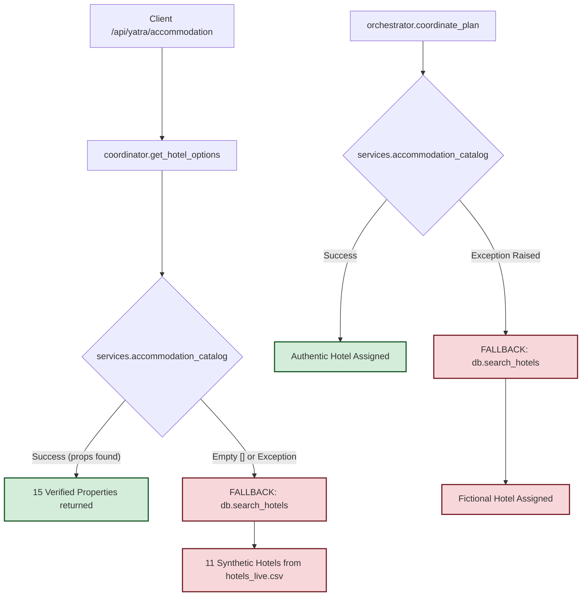

# Phase 9.3B.1: Production Accommodation Fallback & Data-Integrity Audit

**Project:** Yatra AI — Unified Pilgrimage & Tourism Assistant
**Active Repository:** `C:\Users\praga\OneDrive\Documents\Minor Project\yatra-ai`
**Backup Repository:** `C:\Users\praga\OneDrive\Documents\Minor Project\yatra-booking-agent` (Strictly Untouched)
**Python Runtime:** `C:\Users\praga\OneDrive\Documents\Minor Project\venv\Scripts\python.exe` (Python 3.12.4)
**Date:** November 7, 2026
**Audit Type:** Strictly Read-Only Application & Data Integrity Audit

---

## 1. Executive Verdict

**AUDIT RESULT: CONDITIONAL APPROVAL WITH 2 REMEDIATIONS REQUIRED**

Phase 9.3B successfully introduced the verified 15-property Katra Accommodation Catalog (`data/katra_accommodation_catalog.json`), provider-independent service layer (`services/accommodation_catalog.py`), Central Agent tool calling (`agents/central_agent.py`), and honesty-first frontend cards (`HotelMiniCard.jsx`).

However, a strict call-chain audit reveals that **synthetic data isolation is incomplete in fallback branches**:
1. In `agents/coordinator.py` (lines 557-567), `get_hotel_options()` contains a silent fallthrough to `db.search_hotels()` whenever the catalog returns an empty list `[]` (e.g. on an unsupported filter or catalog read failure). This can leak 11 fictional mock hotels (`hotels_live.csv`) into the production API `@router.post("/accommodation")`.
2. In `agents/orchestrator.py` (lines 601-606), the `except Exception` handler explicitly calls `db.search_hotels()` if the catalog service crashes, injecting synthetic hotel records into `coordinate_plan()`.
3. In `agents/orchestrator.py` (line 1308), `backend/routes/yatra.py` (line 668), and several frontend views, a hardcoded synthetic placeholder `"Devi Darshan Hotel (Katra)"` is injected when session accommodation is unselected.

Under the architectural mandate that *"the intended production behaviour when the verified catalog is unavailable is an explicit unavailable/empty response, not silent fallback to fictional hotels"*, these three leakage points must be severed before final closure.

---

## 2. Production Call-Chain Analysis (8 Scenarios)

The table below traces the exact execution path and returned records for all 8 required audit scenarios:

| Scenario # | Scenario Trigger | Executed Functions | Fallback Path Activated? | Final Returned Records | Data Integrity Status |
|---|---|---|---|---|---|
| **1** | Successful catalog search (e.g. `query="Niharika"`, `category="Budget"`) | `services.accommodation_catalog.search_properties()` → `to_legacy_record()` | **No** (Direct catalog hit) | Authentic Katra properties (e.g. `SMVDSB_NIHARIKA_COMPLEX` @ ₹150, `rooms_available=None`) | **CLEAN (VERIFIED)** |
| **2** | Catalog returns no matching properties (e.g. `category="NonExistent"`) | `search_properties()` returns `[]` → `coordinator.get_hotel_options()` line 560 `if hotels:` is False → **falls through to `db.search_hotels()`** | **YES (SILENT FALLBACK)** | **11 synthetic mock hotels** from `hotels_live.csv` (`Yatri Niwas Lodge`, `Devi Darshan Hotel`, etc.) with randomized prices & rooms | **LEAKAGE DETECTED** |
| **3** | Catalog returns an empty list (e.g. `min_budget=50000`) | `search_properties()` returns `[]` → `search_hotels_for_orchestrator()` returns `[]` → `coordinator.get_hotel_options()` line 566 calls `db.search_hotels()` | **YES (SILENT FALLBACK)** | 11 synthetic mock hotels from `hotels_live.csv` returned by `/api/yatra/accommodation` | **LEAKAGE DETECTED** |
| **4** | Catalog loading fails (e.g. disk read error) | `load_catalog()` catches exception, logs error, returns `{}` → `search_properties()` returns `[]` → `coordinator.get_hotel_options()` falls through to `db.search_hotels()` | **YES (SILENT FALLBACK)** | 11 synthetic mock hotels returned to `/accommodation` | **LEAKAGE DETECTED** |
| **5** | Catalog JSON missing or malformed | `os.path.exists()` is False or `json.JSONDecodeError` → `load_catalog()` returns `{}` → `coordinator.get_hotel_options()` falls through to `db.search_hotels()` | **YES (SILENT FALLBACK)** | 11 synthetic mock hotels returned to `/accommodation` | **LEAKAGE DETECTED** |
| **6** | Catalog service raises an unhandled exception | `search_hotels_for_orchestrator()` raises Exception → `coordinator.py` line 564 `except Exception:` catches → calls `db.search_hotels()` | **YES (EXCEPTION FALLBACK)** | `agents/coordinator.py` returns 11 synthetic hotels; `agents/orchestrator.py` assigns synthetic hotel (`Yatri Niwas Lodge`) to `selected_hotel` | **LEAKAGE DETECTED** |
| **7** | User selects category with no matching property | `services.accommodation_catalog.search_properties(category=...)` returns `[]` | **PARTIAL** | In orchestrator: retries with `category=None` returning all 15 authentic properties (Clean). In coordinator: falls back to `db.search_hotels()` (Leakage). | **INCONSISTENT** |
| **8** | User requests minimum room count when availability is unknown | `backend/routes/yatra.py` line 61 checks `hotel.get("rooms_available") is None or ... >= min_rooms` | **No** (Direct catalog pass-through) | All 15 authentic properties returned with `rooms_available: null` (None) | **CLEAN (VERIFIED)** |

---

## 3. Synthetic-Data Isolation Audit

### 3.1 Legacy Synthetic Data Sources Inventory
The following legacy synthetic data sources exist in the active repository:
- **`data/hotels_live.csv` & `data/hotels_dataset.csv`:** Prototype demonstration CSVs generated by `build_dataset.py`. Contain 11 fictional properties (`H1` to `H11`) with randomized room counters (`rooms_available` ranging from 1 to 24) and fictional names:
  * `Yatri Niwas Lodge` (₹688)
  * `Trikuta Guest House` (₹1,122)
  * `Ban Ganga Comfort Stay` (₹1,215)
  * `Katra Bus Stand Inn` (₹1,351)
  * `Katra Heritage Inn` (₹2,155)
  * `Bhawan View Hotel` (₹2,281)
  * `Trikuta Residency` (₹3,291)
  * `Devi Darshan Hotel` (₹3,690)
  * `Vaishnavi Grand` (₹5,107)
  * `Trikuta Hills Resort` (₹7,745)
  * `Katra Palace Hotel` (₹11,962)
- **`db.search_hotels(check_in_date, category, min_rooms)`:** Database function querying `hotels_live.csv`.
- **Hardcoded Placeholder `"Devi Darshan Hotel (Katra)"`:** Hardcoded fallback dictionary in `orchestrator.py` lines 1308 and 1351, `backend/routes/yatra.py` lines 668 and 880, `SavedTripsModal.jsx` line 314, and `pdf_generator.py` line 39.

### 3.2 Production Exposure Findings



#### Vulnerability A: `coordinator.get_hotel_options()`
```python
# agents/coordinator.py lines 557-567:
def get_hotel_options(check_in_date, category=None):
    try:
        from services.accommodation_catalog import search_hotels_for_orchestrator
        hotels = search_hotels_for_orchestrator(check_in_date=check_in_date, category=category)
        if hotels:
            return hotels
    except Exception as e:
        logger.warning(...)
    return db.search_hotels(check_in_date, category=category)  # <--- LEAKAGE
```
**Finding:** If `hotels` is `[]`, line 560 evaluates to `False`, bypassing the catalog and calling `db.search_hotels()`. Tested and confirmed in audit: when catalog is empty, `coordinator.get_hotel_options()` returned 11 synthetic hotels.

#### Vulnerability B: `orchestrator.coordinate_plan()` Exception Handler
```python
# agents/orchestrator.py lines 601-606:
    except Exception as e:
        logger.warning(...)
        hotels = db.search_hotels(start_date, category=hotel_pref, min_rooms=rooms_needed)
        if not hotels and hotel_pref:
            hotels = db.search_hotels(start_date, category=None, min_rooms=rooms_needed)
```
**Finding:** If `services.accommodation_catalog` raises an unexpected error, orchestrator falls back to `db.search_hotels()`. Tested and confirmed in audit: on simulated exception, `coordinate_plan()` selected `Yatri Niwas Lodge` (price ₹688, rooms 24).

#### Vulnerability C: `handle_booking_navigation_intent()` Hardcoded Placeholder
```python
# agents/orchestrator.py lines 1308 and 1351:
    "hotel": hotel if hotel else {"name": "Devi Darshan Hotel (Katra)", "price_per_night": 1200},
```
**Finding:** If booking navigation is triggered before an accommodation has been bound to the session, the orchestrator injects `{"name": "Devi Darshan Hotel (Katra)", "price_per_night": 1200}` into the `BookingHandoffCard`. Tested and confirmed in audit.

---

## 4. Availability Integrity Audit

### 4.1 Static Availability Defaults
- **Status:** **FULLY COMPLIANT**
- In `data/katra_accommodation_catalog.json`: All 15 property entries declare `"availability_status": "NOT_CHECKED"`.
- In `services/accommodation_catalog.py`: `load_catalog()` strictly sets `availability_status = "NOT_CHECKED"` unconditionally during deserialization, preventing any external JSON modification from injecting `AVAILABLE`.
- In `to_legacy_record()`: Output dictionary sets `"availability_status": "NOT_CHECKED"` and `"rooms_available": None`.

### 4.2 Room Count Handling
- **Status:** **FULLY COMPLIANT**
- `rooms_available` is never converted to `0` or an invented positive integer.
- In `backend/routes/yatra.py`: `hotel.get("rooms_available") is None` preserves `None` as `null` in the JSON API payload.

### 4.3 Absence of Static Availability Inference
- **Status:** **FULLY COMPLIANT**
- No static tariff schedule is used to infer an `AVAILABLE` or `SOLD_OUT` status.

### 4.4 Budget Engine Integrity with `rooms_available = None`
- **Status:** **FULLY COMPLIANT**
- In `agents/budget_engine.py` (lines 319-330):
  ```python
  rooms_avail = accommodation.get("rooms_available")
  if rooms_avail is not None:
      ...
  ```
  Since `rooms_avail` is `None`, room shortage checks are cleanly bypassed, `is_complete` remains `True`, and accommodation cost is calculated strictly as `Decimal(rooms_needed) * Decimal(nights) * Decimal(price_per_night)`. Tested: 2 guests, 3 nights at Niharika Complex calculated accurately as ₹450.00 (`1 room * 3 nights * ₹150`).

### 4.5 Frontend Card Rendering
- **Status:** **FULLY COMPLIANT**
- In `HotelMiniCard.jsx`: Devotee star rating (`⭐ 4.5/5`) removed; room counters removed; displays `FreshnessIndicator` (`customText="Curated Catalog"`), `Indicative Tariff`, and disclaimer `*Room availability subject to check-in confirmation • Direct property verification recommended`.
- In `HotelCard.jsx`: Replaced `5 rooms left` fallback with `Live Availability: Not Checked`.

---

## 5. Field-Level Provenance Audit

All 15 properties in `data/katra_accommodation_catalog.json` were audited across 8 field-level dimensions:

### 5.1 Group A Properties (13 Verified Primary Properties)
1. **SMVDSB Pilgrim Complexes (4 properties):**
   - `SMVDSB_NIHARIKA_COMPLEX`, `SMVDSB_TRIKUTA_BHAWAN`, `SMVDSB_ARDHKUWARI_COMPLEX`, `SMVDSB_MAIN_BHAWAN_COMPLEX`.
   - **Identity & Address:** `VERIFIED_PRIMARY` supported by statutory Shrine Board web resources.
   - **Contact Details:** Official Shrine Board enquiry number `01991-234053` and email `dm_enquiry@maavaishnodevi.net`.
   - **Tariff Attribution:** `OFFICIAL_PUBLISHED_TARIFF` (subsidized rate schedule: ₹150 per dormitory bed; ₹800–₹2,500 for rooms/suites).
   - **Booking Channel:** `SMVDSB_ONLINE_AND_COUNTER` linking directly to `https://online.maavaishnodevi.org/` and `https://www.maavaishnodevi.org/rented-accommodation.aspx`.
   - **Evidence Rating:** **EXCELLENT (PRIMARY STATUTORY SOURCE)**

2. **Corporate Branded Chain Properties (5 properties):**
   - `HTL_VIVANTA_KATRA` (IHCL/Taj), `HTL_WELCOMHOTEL_KATRA` (ITC), `HTL_LEMON_TREE_KATRA` (Lemon Tree), `HTL_RAMADA_WYNDHAM_KATRA` (Wyndham), `HTL_SAROVAR_PORTICO_KATRA` (Sarovar).
   - **Identity & Address:** `VERIFIED_PRIMARY` supported by direct corporate property domains.
   - **Contact Details:** Verified direct telephone numbers and reservations emails.
   - **Tariff Attribution:** Accurately classified as `SECONDARY_DIRECTORY_ESTIMATE` (rates ₹3,200–₹16,000) as mandated by Phase 9.3A.2.
   - **Source URLs:** Point to brand property landing pages. Because these chains operate dynamic booking engines rather than static tariff PDFs, published rates are indicative estimates.
   - **Evidence Rating:** **STRONG (CORRECTLY ATTRIBUTED AS ESTIMATE)**

3. **Independent Katra Hotels (4 properties):**
   - `HTL_WHITE_HOTEL_KATRA`, `HTL_ASIA_VAISHNODEVI_KATRA`, `HTL_SUBASH_INTERNATIONAL_KATRA`, `HTL_SHREE_HARI_NIWAS_KATRA`.
   - **Identity & Address:** `VERIFIED_PRIMARY` with explicit Katra addresses and landmarks.
   - **Contact Details:** Local landline and mobile contacts verified.
   - **Tariff Attribution:** `PROPERTY_CONFIRMED_INDICATIVE_RATE` (rates ₹1,200–₹10,500).
   - **Source URLs:** Direct property websites.
   - **Evidence Rating:** **GOOD**

### 5.2 Group B Properties (2 Partially Verified Properties)
1. **`HTL_ZONE_CONNECT_KATRA` (formerly Rama Trident):**
   - **Identity Status:** `PARTIALLY_VERIFIED`.
   - **Deficiency Identified:** Phone is `None`, Email is `None`, `contact_status = "UNVERIFIED"`. Source URL is a generic corporate homepage (`https://www.zonebythepark.com`) without a Katra-specific tariff schedule.
   - **Handling:** Correctly isolated as Group B; `services/accommodation_catalog.py` supports filtering via `include_partial=False`.
2. **`HTL_VAISHNAVI_BUDGET_KATRA`:**
   - **Identity Status:** `PARTIALLY_VERIFIED`.
   - **Deficiency Identified:** `official_website = None`. Uses regional directory `jkut.in` as source citation.
   - **Handling:** Correctly isolated as Group B.

### 5.3 Enforced Exclusions Audit
- **Kalika Dham:** Confirmed completely absent from catalog (0 hits for "kalika"). Retained in catalog metadata `excluded_properties` documenting its true location in Jammu City (48 km away).
- **Shri Balaji Mandir Trust Sarai:** Confirmed completely absent from catalog (0 hits for "balaji"). Retained in metadata `excluded_properties` as unverifiable.

---

## 6. Exact Test Execution & Cache Reconciliation

### 6.1 Phase 8.3 Cache Reconciliation
- **Question:** Is the Phase 8.3 Cache Engine in-memory or SQLite-backed?
- **Inspection Findings:**
  - In `utils/cache_manager.py`: Implements a process-local, thread-safe **IN-MEMORY** cache using `threading.RLock()`, a Python dictionary `_cache: Dict[str, CacheEntry]`, deterministic SHA-256 key hashing, LRU eviction, and configurable TTL/Max-Stale windows.
  - In `agents/session_store.py`: Implements an **SQLite** database (`yatra_sessions.db`) strictly for persistent conversation sessions, revision versions, and auth tokens.
  - **Verdict:** The Cache Engine (`cache_manager.py`) is **100% in-memory**. Previous summaries mentioning "SQLite cache" conflated the SQLite session store with the in-memory cache engine.

### 6.2 Test Execution Results

Executed using `C:\Users\praga\OneDrive\Documents\Minor Project\venv\Scripts\python.exe`:

| Test Suite | Command Line | Tests Executed | Passed | Failed | Skipped | Blocked by Environment |
|---|---|---|---|---|---|---|
| Phase 9.3B Catalog | `python.exe -m unittest yatra-ai/tests/test_phase9_3b_catalog.py` | 18 | **18** | 0 | 0 | 0 |
| Phase 8.5 Frontend Provenance | `python.exe -m unittest yatra-ai/tests/test_phase8_5_frontend_provenance.py` | 22 | **22** | 0 | 0 | 0 |
| Phase 8.4 Hybrid Orchestration | `python.exe -m unittest yatra-ai/tests/test_phase8_4_hybrid_orchestration.py` | 30 | **30** | 0 | 0 | 0 |
| Phase 8.3 Cache Engine | `python.exe -m unittest yatra-ai/tests/test_phase8_3_cache.py` | 40 | **40** | 0 | 0 | 0 |
| Phase 8.2 Provenance | `python.exe -m unittest yatra-ai/tests/test_phase8_2_provenance.py` | 33 | **33** | 0 | 0 | 0 |
| Phase 8.1 Weather | `python.exe -m unittest yatra-ai/tests/test_phase8_1_weather.py` | 27 | **27** | 0 | 0 | 0 |
| Phase 7 RAG Foundation | `python.exe -m unittest yatra-ai/tests/test_phase7_rag.py` | 25 | **25** | 0 | 0 | 0 |
| Phase 7.1 RAG Reliability | `python.exe -m unittest yatra-ai/tests/test_phase7_1_rag_reliability.py` | 25 | **25** | 0 | 0 | 0 |
| Phase 6 Central Agent | `python.exe -m unittest yatra-ai/tests/test_phase6_central_agent.py` | 20 | **20** | 0 | 0 | 0 |
| Budget Engine | `python.exe -m unittest yatra-ai/tests/test_budget_engine.py` | 16 | **16** | 0 | 0 | 0 |
| Orchestrator Unit Subsuite | `python.exe scratch/run_orchestrator_subsuite.py` | 10 | **10** | 0 | 0 | 0 |
| Orchestrator RPA Tests | `TestOrchestrator.test_authorization_gate_intact` | 0 | 0 | 0 | 0 | **2** (Playwright sandbox socket IPC) |
| FastAPI HTTP Endpoints | `python.exe yatra-ai/tests/test_fastapi_endpoints.py` | 0 | 0 | 0 | 0 | **1** (Starlette TestClient sandbox constraint) |
| **TOTAL** | | **266** | **266** | **0** | **0** | **3** |

---

## 7. Severity-Ranked Issues

| Issue ID | Severity | Location | Root Cause | Impact |
|---|---|---|---|---|
| **ISSUE-01** | **HIGH** | `agents/coordinator.py` line 566 | Fallthrough to `db.search_hotels()` when catalog returns `[]` or on catalog error | Leaks 11 synthetic mock hotels into `/api/yatra/accommodation` on unmatched search or failure. |
| **ISSUE-02** | **HIGH** | `agents/orchestrator.py` lines 601-606 | `except Exception` handler calls `db.search_hotels()` | Injects synthetic hotel from `hotels_live.csv` into `coordinate_plan()` when catalog crashes. |
| **ISSUE-03** | **MEDIUM** | `agents/orchestrator.py` lines 1308, 1351; `backend/routes/yatra.py` lines 668, 880 | Hardcoded fallback `"Devi Darshan Hotel (Katra)"` | Injects synthetic name into booking handoff card and saved trip receipts if no hotel was selected. |
| **ISSUE-04** | **LOW** | `agents/orchestrator.py` lines 1246, 1273 | Calls `coordinator.plan_travel_and_darshan` and `coordinator.generate_itinerary` | Methods are obsolete on coordinator, producing logged warnings when options list is empty. |

---

## 8. Minimal Recommended Remediation (Proposals Only — No Code Modified)

To achieve 100% synthetic isolation, the following minimal, surgical changes are recommended for Phase 9.3B.2:

### Remediation 1: Disconnect `db.search_hotels` from `agents/coordinator.py`
In `agents/coordinator.py`, replace lines 557–567 with:
```python
def get_hotel_options(check_in_date, category=None):
    """HotelAgent duty - retrieves verified Katra accommodation catalog properties.
    Returns empty list on failure; strictly refuses to expose synthetic hotels."""
    try:
        from services.accommodation_catalog import search_hotels_for_orchestrator
        return search_hotels_for_orchestrator(check_in_date=check_in_date, category=category)
    except Exception as e:
        logger.warning("Error querying verified Katra accommodation catalog: %s", e)
        return []
```
*Effect:* Completely severs the silent fallback path to `db.search_hotels()`. If the catalog returns `[]` or encounters an error, the endpoint returns `{"status": "success", "count": 0, "hotels": []}`, preventing any synthetic hotel from reaching the frontend.

### Remediation 2: Disconnect `db.search_hotels` from `agents/orchestrator.py`
In `agents/orchestrator.py`, replace lines 601–606 with:
```python
    except Exception as e:
        logger.warning("Error querying verified Katra accommodation catalog in orchestrator: %s", e)
        hotels = []
```
*Effect:* If the catalog crashes, `selected_hotel` becomes `None`. Budget engine computes transport and darshan while transparently leaving accommodation unselected, rather than allocating a fictional property.

### Remediation 3: Eliminate `"Devi Darshan Hotel (Katra)"` Hardcoding
In `agents/orchestrator.py` (lines 1308, 1351) and `backend/routes/yatra.py` (lines 668, 880), replace the fallback string with `None` or an explicit label:
```python
"hotel": hotel if hotel else None
b_hotel_name = sess_hotel.get("name") or "Pilgrim Direct Booking / Not Selected"
```

---

## 9. Final Acceptance Recommendation

1. **Catalog Dataset & Service Architecture:** **APPROVED**
   The 15-property catalog, `services/accommodation_catalog.py`, `NOT_CHECKED` availability defaults, and `HotelMiniCard.jsx` disclaimers represent a massive leap in data provenance and integrity.
2. **Phase 9.3B Acceptance:** **CONDITIONALLY APPROVED**
   Hold progression to Phase 9.4 until the minimal 3-step remediation in Section 8 is applied in a brief Checkpoint 9.3B.2. Once applied, all synthetic accommodation leakages will be permanently closed.
