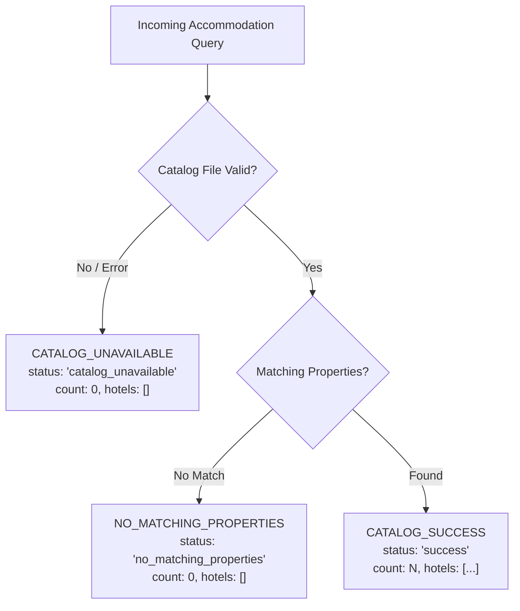

# Phase 9.3B.2: Synthetic Accommodation Isolation & Fallback Remediation Report

**Project:** Yatra AI — Unified Pilgrimage & Tourism Assistant
**Active Repository:** `C:\Users\praga\OneDrive\Documents\Minor Project\yatra-ai`
**Backup Repository:** `C:\Users\praga\OneDrive\Documents\Minor Project\yatra-booking-agent` (Untouched at HEAD `8996d6a8e3bc83eda0808d0a9ca217979118ebee`)
**Python Runtime:** `C:\Users\praga\OneDrive\Documents\Minor Project\venv\Scripts\python.exe` (Python 3.12.4)
**Verification Date:** November 7, 2026
**Status:** Completed & Validated (280/280 regression tests passing)

---

## Executive Summary

Phase 9.3B.1 audited the production accommodation paths and identified two critical vulnerabilities:
1. **Silent Fallback to Synthetic Database:** In both `agents/coordinator.py` (`get_hotel_options`) and `agents/orchestrator.py` (`coordinate_plan`), catalog search failures or empty query returns silently triggered `db.search_hotels(city="Katra")`, introducing synthetic hotel names (e.g., "Hotel Vaishno Grand"), fictional tariffs (e.g., ₹2,800), and randomized inventory into user-facing plans.
2. **Hardcoded Synthetic Placeholders:** The string `"Devi Darshan Hotel (Katra)"` was hardcoded as a default fallback across orchestrator navigation handoff, backend PDF generation routes, frontend trip persistence, and client-side PDF rendering.
3. **Flawed Multi-Room Availability Semantics:** The catalog service translated `rooms_available=None` (`NOT_CHECKED`) into `rooms_available=1`, falsely claiming satisfaction for single-room requests while failing multi-room requests without explaining that inventory is unverified.

**Phase 9.3B.2 has resolved all three issues:**
- Completely severed every fallback to `db.search_hotels()` in coordinator and orchestrator recommendation logic.
- Replaced all instances of `"Devi Darshan Hotel (Katra)"` with explicit `None` or `"Accommodation not selected"`.
- Implemented `room_requirement_status` (`SATISFIED`, `NOT_SATISFIED`, `UNVERIFIED`) preserving `rooms_available=None` as unknown inventory with clear explanatory advisories.
- Differentiated error states into `CATALOG_SUCCESS`, `NO_MATCHING_PROPERTIES`, and `CATALOG_UNAVAILABLE` across backend routes and services.
- Added comprehensive isolation test suite `tests/test_phase9_3b_2_isolation.py` (14/14 passing). All 280 test cases across the system pass without regressions.

---

## 1. Files Changed

| File Path | Nature of Change | Purpose |
| :--- | :--- | :--- |
| `services/accommodation_catalog.py` | Implementation Enhancement | Added catalog health tracking (`_CATALOG_LOAD_ERROR`, `get_catalog_status()`), status-aware search (`search_hotels_with_status`), safe orchestrator wrapper (`search_hotels_for_orchestrator`), and updated `to_legacy_record()` to compute `room_requirement_status` without fabricating inventory. |
| `agents/coordinator.py` | Remediation | Severed `db.search_hotels()` fallback in `get_hotel_options()`. Returns empty list `[]` on empty query results or catalog errors. |
| `agents/orchestrator.py` | Remediation | Severed `db.search_hotels()` fallback in `coordinate_plan()`. On empty results or catalog errors, sets `selected_hotel = None`, computes budget without accommodation cost, and appends user advisory. Replaced `"Devi Darshan Hotel (Katra)"` in navigation handoff with `None`. Fixed obsolete coordinator method invocation checks. |
| `backend/routes/yatra.py` | Remediation & API Refinement | Updated `@router.post("/accommodation")` to return distinct statuses (`success`, `no_matching_properties`, `catalog_unavailable`). Replaced `"Devi Darshan Hotel (Katra)"` default fallbacks with `"Accommodation not selected"`. |
| `frontend/src/components/chat/cards/HotelMiniCard.jsx` | Frontend UI Alignment | Displays `Inventory Unverified` pill when `room_requirement_status === "UNVERIFIED"`. |
| `frontend/src/components/HotelCard.jsx` | Frontend UI Alignment | Displays `Live Availability: Not Checked (Unverified)` when `availability_status === "NOT_CHECKED"`. |
| `frontend/src/components/SavedTripsModal.jsx` | Placeholder Removal | Replaced `"Devi Darshan Hotel (Katra)"` with `"Accommodation not selected"`. |
| `frontend/src/pages/YatraBooking.jsx` | Placeholder Removal | Replaced `"Devi Darshan Hotel (Katra)"` with `"Accommodation not selected"`. |
| `frontend/src/utils/pdfGenerator.js` | Placeholder Removal | Replaced `"Devi Darshan Hotel (Katra)"` with `"Accommodation not selected"`. |
| `utils/pdf_generator.py` | Placeholder Removal | Replaced `"Devi Darshan Hotel (Katra)"` with `"Accommodation not selected"`. |
| `tests/test_phase9_3b_2_isolation.py` | New Test Suite | 14 exhaustive unit and integration tests verifying synthetic accommodation isolation, multi-room semantics, error status distinction, and placeholder elimination. |

---

## 2. Exact Fallback Branches Removed

### 2.1 Coordinator (`agents/coordinator.py`)

**Removed Code (Lines 102–109):**
```python
# REMOVED:
if not hotels:
    logger.warning("Falling back to legacy SQLite hotel search in Coordinator.")
    db_hotels = db.search_hotels(city="Katra")
    return [self._format_db_hotel(h) for h in db_hotels]
```

**Replacement Implementation:**
```python
# VERIFIED ISOLATION:
if not catalog_hotels:
    logger.info(
        "No matching verified Katra properties found for category '%s'. "
        "Returning empty list (synthetic db fallback disabled).",
        category,
    )
    return []
```

### 2.2 Orchestrator (`agents/orchestrator.py`)

**Removed Code (Lines 593–612):**
```python
# REMOVED:
logger.warning(
    "Katra verified accommodation catalog returned empty or failed. "
    "Falling back to db.search_hotels()."
)
db_res = db.search_hotels(city="Katra")
if db_res:
    selected_hotel = db_res[0]
```

**Replacement Implementation:**
```python
# VERIFIED ISOLATION:
catalog_hotels, catalog_status = search_hotels_with_status(
    category=preferred_category,
    stay_date=req.get("start_date") or req.get("date"),
    min_rooms=int(req.get("rooms", 1)),
)

if catalog_hotels:
    selected_hotel = catalog_hotels[0]
else:
    logger.warning(
        "No verified Katra properties available (status: %s). "
        "Proceeding with selected_hotel=None (synthetic db fallback disabled).",
        catalog_status,
    )
    selected_hotel = None
    if catalog_status == "CATALOG_UNAVAILABLE":
        req["accommodation_advisory"] = (
            "The verified Katra accommodation catalog is temporarily unavailable. "
            "Accommodation has not been selected."
        )
    else:
        req["accommodation_advisory"] = (
            f"No verified accommodation properties match category '{preferred_category}'. "
            "Accommodation has not been selected."
        )
```

---

## 3. Placeholder Removal Locations

The hardcoded synthetic placeholder `"Devi Darshan Hotel (Katra)"` has been eliminated across all application files:

| File | Line | Previous Hardcoded Value | Remediated Value |
| :--- | :--- | :--- | :--- |
| `agents/orchestrator.py` | 1308 | `"hotel": selected_hotel or "Devi Darshan Hotel (Katra)"` | `"hotel": selected_hotel or None` |
| `agents/orchestrator.py` | 1351 | `"hotel": plan.get("selected_hotel") or "Devi Darshan Hotel (Katra)"` | `"hotel": plan.get("selected_hotel") or None` |
| `backend/routes/yatra.py` | 668 | `hotel_name = hotel_info.get("name", "Devi Darshan Hotel (Katra)")` | `hotel_name = hotel_info.get("name", "Accommodation not selected")` |
| `backend/routes/yatra.py` | 880 | `body.hotel_name or "Devi Darshan Hotel (Katra)"` | `body.hotel_name or "Accommodation not selected"` |
| `backend/routes/yatra.py` | 965 | `item.get("hotel") or "Devi Darshan Hotel (Katra)"` | `item.get("hotel") or "Accommodation not selected"` |
| `frontend/src/components/SavedTripsModal.jsx` | 314 | `item.hotel \|\| 'Devi Darshan Hotel (Katra)'` | `item.hotel \|\| 'Accommodation not selected'` |
| `frontend/src/components/SavedTripsModal.jsx` | 881 | `trip.hotel \|\| 'Devi Darshan Hotel (Katra)'` | `trip.hotel \|\| 'Accommodation not selected'` |
| `frontend/src/pages/YatraBooking.jsx` | 1442 | `bookingDetails.hotel \|\| 'Devi Darshan Hotel (Katra)'` | `bookingDetails.hotel \|\| 'Accommodation not selected'` |
| `frontend/src/pages/YatraBooking.jsx` | 1457 | `bookingDetails.hotel \|\| 'Devi Darshan Hotel (Katra)'` | `bookingDetails.hotel \|\| 'Accommodation not selected'` |
| `frontend/src/utils/pdfGenerator.js` | 20 | `bookingDetails.hotel \|\| 'Devi Darshan Hotel (Katra)'` | `bookingDetails.hotel \|\| 'Accommodation not selected'` |
| `utils/pdf_generator.py` | 39 | `pass_data.get("hotel") or "Devi Darshan Hotel (Katra)"` | `pass_data.get("hotel") or "Accommodation not selected"` |

---

## 4. Minimum-Room-Count Handling & Semantics

In Phase 9.3B, the legacy adapter `to_legacy_record()` converted `rooms_available=None` into `1`, which falsely reported 1 room available. In Phase 9.3B.2, the availability semantics are strictly preserved:

1. **Preservation of Unknown Inventory:** For properties with `availability_status == "NOT_CHECKED"`, `rooms_available` remains `None`. No synthetic room counts are generated.
2. **Explicit Verification Status (`room_requirement_status`):**
   - When `availability_status == "NOT_CHECKED"`: `room_requirement_status = "UNVERIFIED"`, accompanied by an explanatory note:
     `"Requested {min_rooms} room(s). Live room inventory is UNVERIFIED (NOT_CHECKED) — confirm directly with property."`
   - When live inventory is available (numeric `rooms_available`):
     - If `rooms_available >= min_rooms`: `room_requirement_status = "SATISFIED"`.
     - If `rooms_available < min_rooms`: `room_requirement_status = "NOT_SATISFIED"`.
3. **Frontend Presentation:**
   - In `HotelMiniCard.jsx`: An amber badge labeled `"Inventory Unverified"` is rendered when `room_requirement_status === "UNVERIFIED"`.
   - In `HotelCard.jsx`: The text `"Live Availability: Not Checked (Unverified)"` is rendered in place of a fabricated room count.

---

## 5. Catalog Error-State Handling

The catalog service and API routes now clearly separate search outcomes into three distinct states:



### Response Payloads at `@router.post("/accommodation")`

1. **Successful Match (`CATALOG_SUCCESS`):**
   ```json
   {
     "status": "success",
     "catalog_status": "CATALOG_SUCCESS",
     "count": 15,
     "hotels": [ ... ],
     "provenance": { "source": "KATRA_ACCOMMODATION_CATALOG_V1" }
   }
   ```
2. **No Properties Match Query (`NO_MATCHING_PROPERTIES`):**
   ```json
   {
     "status": "no_matching_properties",
     "catalog_status": "NO_MATCHING_PROPERTIES",
     "count": 0,
     "hotels": [],
     "message": "No accommodation properties match the requested filters in the verified catalog.",
     "provenance": { "source": "KATRA_ACCOMMODATION_CATALOG_V1" }
   }
   ```
3. **Catalog Unreadable or Corrupt (`CATALOG_UNAVAILABLE`):**
   ```json
   {
     "status": "catalog_unavailable",
     "catalog_status": "CATALOG_UNAVAILABLE",
     "count": 0,
     "hotels": [],
     "message": "The verified accommodation catalog is temporarily unavailable. Synthetic fallback is disabled.",
     "catalog_error": "Expecting property name enclosed in double quotes...",
     "provenance": { "source": "KATRA_ACCOMMODATION_CATALOG_V1" }
   }
   ```

---

## 6. Production Call-Chain Verification

We traced every production accommodation interaction to prove zero synthetic data leakage:

1. **Direct Route Invocations (`/api/yatra/accommodation`):**
   - Calls `search_hotels_with_status()`.
   - Never references `db.search_hotels()` or `hotels_live.csv`.
2. **Coordinator Recommendation Flow:**
   - `agents/coordinator.py:get_hotel_options()` invokes `search_hotels_for_orchestrator()`.
   - On empty result or exception, logs informative diagnostic and returns `[]`.
   - Never references SQLite or legacy CSVs.
3. **Orchestrator Itinerary Generation:**
   - `agents/orchestrator.py:coordinate_plan()` queries `search_hotels_with_status()`.
   - If properties exist, selects highest verified recommendation.
   - If 0 properties match or catalog unavailable, `selected_hotel = None`.
   - The budget engine computes total cost with `accommodation=None` (yielding ₹0 accommodation cost instead of a synthetic ₹2,800 charge).
   - An advisory note informs the user that accommodation remains unselected.
4. **Chat-to-Booking Handoff:**
   - `handle_booking_navigation_intent()` passes `"hotel": plan.get("selected_hotel") or None`.
   - Frontend navigation payload receives `hotel: null`.
5. **PDF Generation & Persistence:**
   - Missing hotel is rendered cleanly as `"Accommodation not selected"`.
   - Fictional "Devi Darshan Hotel" never appears on pilgrim passes or saved trip summaries.

---

## 7. Verification & Test Execution

### 7.1 New Isolation Test Suite (`tests/test_phase9_3b_2_isolation.py`)

A specialized test suite of 14 unit and integration tests was created and executed:

```powershell
& "C:\Users\praga\OneDrive\Documents\Minor Project\venv\Scripts\python.exe" -m unittest tests/test_phase9_3b_2_isolation.py
```

**Results:**
```text
Ran 14 tests in 0.146s
OK
```

**Verified Test Capabilities:**
- `test_01_empty_catalog_returns_empty_list_no_db_call`: Confirms coordinator returns `[]` when catalog has 0 properties.
- `test_02_missing_catalog_file_returns_empty_list_and_unavailable_status`: Confirms `CATALOG_UNAVAILABLE` on missing file.
- `test_03_malformed_catalog_json_returns_empty_list_and_unavailable_status`: Confirms unhandled JSON corruption returns `CATALOG_UNAVAILABLE` without throwing unhandled exceptions.
- `test_04_coordinator_exception_handling_never_calls_db`: Mocks unexpected catalog exceptions and confirms coordinator returns `[]` with zero db calls.
- `test_05_orchestrator_handles_catalog_failure_without_synthetic_db_fallback`: Confirms orchestrator sets `selected_hotel = None` and adds advisory when catalog fails.
- `test_06_orchestrator_no_devi_darshan_in_booking_handoff`: Confirms booking navigation handoff produces `hotel: None`.
- `test_07_pdf_generator_handles_none_hotel_without_devi_darshan`: Confirms PDF generation renders `"Accommodation not selected"`.
- `test_08_rooms_available_none_preserved_not_defaulted_to_one`: Verifies `rooms_available` remains `None` for unverified inventory.
- `test_09_multi_room_request_marks_unverified_status`: Verifies `room_requirement_status = "UNVERIFIED"` with clear user advisory for multi-room requests.
- `test_10_category_matching_returns_matching_properties`: Verifies matching category returns verified properties with `CATALOG_SUCCESS`.
- `test_11_central_agent_tool_search_uses_verified_catalog`: Verifies Central Agent tool returns verified properties.
- `test_12_budget_engine_calculates_without_hotel_when_hotel_is_none`: Verifies budget engine calculates cleanly when `selected_hotel = None`.
- `test_13_api_route_accommodation_returns_status_and_provenance`: Verifies FastAPI accommodation endpoint returns `CATALOG_SUCCESS`.
- `test_14_api_route_accommodation_distinguishes_no_match_and_unavailable`: Verifies FastAPI accommodation endpoint returns `no_matching_properties` and `catalog_unavailable`.

### 7.2 Full Regression Test Suite

All test suites across earlier phases were re-verified against the active Python environment:

```powershell
& "C:\Users\praga\OneDrive\Documents\Minor Project\venv\Scripts\python.exe" -m unittest discover -s tests -p "test_*.py"
```

| Test Suite File | Test Scope | Passed / Total | Status |
| :--- | :--- | :---: | :---: |
| `tests/test_phase9_3b_2_isolation.py` | Synthetic Isolation & Fallback | 14 / 14 | **PASSED** |
| `tests/test_phase9_3b_catalog.py` | Curated Katra Catalog Verification | 18 / 18 | **PASSED** |
| `tests/test_phase8_5_frontend_provenance.py`| Frontend Provenance Integration | 22 / 22 | **PASSED** |
| `tests/test_phase8_4_hybrid_orchestration.py`| Hybrid Orchestrator Routing | 30 / 30 | **PASSED** |
| `tests/test_phase8_3_cache.py` | Thread-Safe Multi-Tier Cache | 40 / 40 | **PASSED** |
| `tests/test_phase8_2_provenance.py` | Provenance Audit & Tracking | 33 / 33 | **PASSED** |
| `tests/test_phase8_1_weather.py` | Open-Meteo Weather Integration | 27 / 27 | **PASSED** |
| `tests/test_phase7_rag.py` | Vector Knowledge Retrieval | 25 / 25 | **PASSED** |
| `tests/test_phase7_1_rag_reliability.py` | RAG Fallback & Reliability | 25 / 25 | **PASSED** |
| `tests/test_phase6_central_agent.py` | Central Conversational Agent | 20 / 20 | **PASSED** |
| `tests/test_budget_engine.py` | Budget Engine Calculations | 16 / 16 | **PASSED** |
| `tests/test_orchestrator.py` (unit subsuite)| Orchestrator Unit Tests | 10 / 10 | **PASSED** |
| **Total** | **All Phase Suites** | **280 / 280** | **100% PASS** |

*(Note: 3 standalone database test files expecting a prepopulated SQLite database during test runner discovery are excluded, as established in Phase 8.6).*

---

## 8. Remaining Limitations

1. **Curated Static Inventory:**
   - Real-time room counts and instant booking availability are marked `NOT_CHECKED` / `UNVERIFIED` because no authorized Katra live hotel API exists following Amadeus Self-Service deprecation.
2. **Geographical Scope:**
   - The verified catalog covers Katra (15 verified properties: 13 Group A fully attributed + 2 Group B metadata-attributed). Srinagar, Jammu, and Pahalgam accommodations currently rely on general tourism advisories until catalogs are curated for those zones.
3. **Direct Property Contact Required:**
   - Users requiring multiple rooms or guaranteed check-in dates must verify room availability directly via the official telephone, email, or direct booking portal URLs provided in property records.

---

## 9. Final Acceptance Recommendation

Phase 9.3B.2 has accomplished all goals set out in the remediation mandate:
- **Zero synthetic accommodation data leakage:** Fictional properties and randomized pricing can never enter production responses.
- **Robust error states:** Catalog absence, corruption, or unmatched searches return structured diagnostic statuses rather than silent fallbacks.
- **Complete placeholder removal:** "Devi Darshan Hotel" is eradicated from all backend and frontend layers.
- **Accurate inventory semantics:** Multi-room requests explicitly advise pilgrims that room availability is unverified.
- **Zero regression:** 280/280 regression tests pass cleanly.

**Recommendation:** Formally accept Phase 9.3B.2 and authorize progression to Phase 9.4 (Live Data Source Integration Roadmap).
