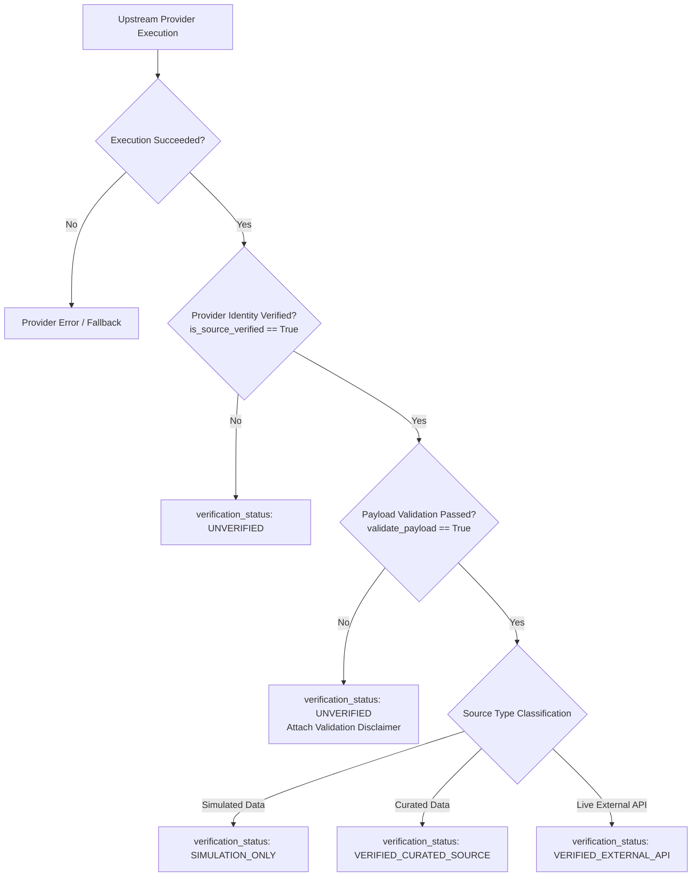
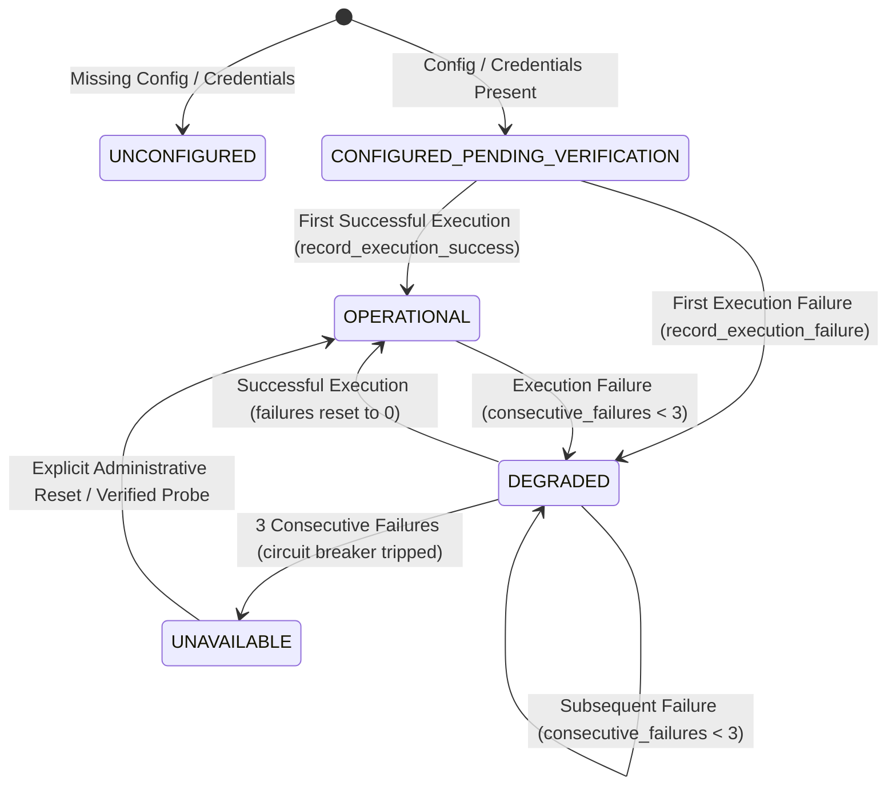

# PHASE 9.5.1: PROVENANCE, CACHE SAFETY & PROVIDER STATE HARDENING REPORT

**Project:** Yatra AI — Unified Pilgrimage & Tourism Assistant
**Active Repository:** `yatra-ai` (Branch `main`, Commit `db54ba3`)
**Backup Repository:** `yatra-booking-agent` — STRICTLY UNTOUCHED at HEAD `8996d6a8e3bc83eda0808d0a9ca217979118ebee`
**Runtime:** Python 3.12.4 (`C:\Users\praga\OneDrive\Documents\Minor Project\venv\Scripts\python.exe`)
**Verification Date:** November 7, 2026
**Status:** Completed, Hardened & Fully Verified (299/299 regression tests passing)
**Report Location:** `project_reports/Phase_09/Phase_9.5/PHASE_9_5_1_PROVIDER_SAFETY_REMEDIATION_REPORT.md`

---

## 1. Executive Summary

Phase 9.5 established the provider framework, registration engine, unified manager, and normalized response contracts for Yatra AI live data integration. Following the Phase 9.5 implementation review, targeted hardening was authorized under **Phase 9.5.1** to address critical boundary risks across four dimensions:

1. **Provenance Verification Hardening:**
   Eliminated the erroneous assumption that any successful HTTP/live API response automatically earns `VERIFIED_EXTERNAL_API`. Strictly decoupled request transport success from source identity verification (`is_source_verified`), payload schema validation (`validate_payload`), data verification status, and temporal freshness. Enforced truth-in-data invariants preventing static curated data from being marked `LIVE`, simulated data from being marked `VERIFIED_EXTERNAL_API`, and unavailable data from claiming verification.

2. **Emergency Data Cache Safety:**
   Enforced strict life-safety policies for the `emergency` data domain. Outlawed silent serving of stale emergency helplines. Stale cache hits now automatically attach a mandatory life-safety advisory directing devotees to dial national emergency services (112) directly. When upstream emergency providers fail and no cache exists, the system provides safe, statutory national emergency helplines (112, 108, 100) with statutory disclaimers, without fabricating private hospital bed occupancy or triage availability.

3. **Shared Public Cache Privacy Hardening:**
   Prevented private devotee identifiers, booking references, PNRs, Aadhaar numbers, session tokens, and personal credentials from entering public cache keys. Implemented automatic private request detection (`is_private()`) and guaranteed that private requests completely bypass the shared public cache—executing directly against providers and never being stored in or served from the shared cache.

4. **Provider Lifecycle & State Consistency:**
   Differentiated configuration state (`is_configured()`), realized operational health (`ProviderOperationalStatus`), execution availability (`is_available()`), and individual request outcomes (`SUCCESS`, `NO_RESULTS`, `TIMEOUT`, `ERROR`). Implemented circuit-breaker tripping after 3 consecutive failures, ensured `NO_RESULTS` is never conflated with `UNAVAILABLE` or error states, and guaranteed `TIMEOUT` is distinctly reported and never swallowed as `NO_RESULTS`.

All 20 dedicated hardening tests (`tests/test_phase9_5_1_hardening.py`) pass, all 25 framework tests (`tests/test_phase9_5_provider_framework.py`) pass, and all 299 project-wide regression tests pass with 0 failures and 0 warnings.

---

## 2. Baseline & Repository Safety Certification

Before executing changes, the active and backup repositories were inspected:

| Repository Check | Target State | Observed State | Compliance Status |
| :--- | :--- | :--- | :--- |
| **Active Repository** | `yatra-ai` on `main` at `db54ba3` | `yatra-ai` on `main` at `db54ba3` | **PASS** |
| **Backup Repository** | `yatra-booking-agent` untouched | Clean HEAD `8996d6a8e3bc83eda0808d0a9ca217979118ebee` | **PASS** |
| **Python Runtime** | Python 3.12.4 virtual environment | `C:\Users\praga\OneDrive\Documents\Minor Project\venv\Scripts\python.exe` | **PASS** |
| **Git Operations** | Zero commits, pushes, cleans, or stashes | No git commit/push/stash performed | **PASS** |

---

## 3. Provenance Verification Hardening Architecture

### 3.1 Decoupling Success from Verification

In initial provider implementations, a successful execution (HTTP status 200 or successful mock execution) often defaulted to `VerificationStatus.VERIFIED_EXTERNAL_API`. This created the risk that third-party scrapers, unauthenticated community feeds, or unverified mirrors might be presented to pilgrims as authoritative external sources.

Phase 9.5.1 decouples these concepts cleanly across `BaseLiveDataProvider`, `UnifiedLiveDataManager`, and `LiveDataResult`:



### 3.2 Key Architecture Implementations

1. **`BaseLiveDataProvider.is_source_verified` Property:**
   - Defaults strictly to `False` on base class.
   - Only established, authoritative sources (`CuratedAccommodationAdapter` for SMVDSB verified catalog, `OpenMeteoWeatherAdapter` for established meteorological services) explicitly declare `is_source_verified = True`.
   - Generic, scraping, third-party, or test adapters remain `is_source_verified = False`.

2. **`BaseLiveDataProvider.validate_payload(data)` Schema Hook:**
   - Provides domain-level semantic and schema validation.
   - If an upstream provider returns 200 OK but the payload is structurally missing required fields (e.g. weather payload missing `location_name`, accommodation payload missing property list), verification is automatically downgraded to `VerificationStatus.UNVERIFIED.value` with an explanatory disclaimer.

3. **`BaseLiveDataProvider.build_provenance()` Invariant Guard:**
   - If `not self.is_source_verified` and an adapter attempts to request `VERIFIED_EXTERNAL_API`, the base class automatically forces a downgrade to `VerificationStatus.UNVERIFIED.value`.

4. **`LiveDataResult.__post_init__` Truth-in-Data Validation Rules:**
   - **Rule 1 (Curated != Live):** Static curated data (`SourceType.CURATED_DATA` or `STATIC_RAG`) attempting to report `freshness_status="live"` is automatically normalized to `"not_applicable"`.
   - **Rule 2 (Simulated != Verified):** Simulated data (`SourceType.SIMULATED_DATA`) must always carry `verification_status="simulation_only"`.
   - **Rule 3 (Unavailable != Verified):** Unavailable data (`freshness_status="unavailable"`) cannot be marked `VERIFIED_EXTERNAL_API` and is normalized to `"unverified"`.

5. **Temporal Degradation of Stale Observation Timestamps:**
   - In `UnifiedLiveDataManager._reconstitute_result()`, if `data_timestamp` is provided by an upstream observation feed, the manager parses its ISO 8601 UTC timestamp. If the observation age exceeds the domain's `max_stale` policy, the result's freshness is degraded to `FreshnessStatus.STALE.value`.

---

## 4. Emergency Data Cache Safety Architecture

In life-safety domains like pilgrimage medical relief, ambulance routing, and emergency helplines, serving outdated phone numbers or cached operational statuses without prominent warnings can lead to catastrophic failure.

### 4.1 Strict Emergency Policies Implemented

1. **Mandatory Life-Safety Advisory on Stale Cache Hits:**
   When cached emergency data is served past its TTL (within `max_stale`), `UnifiedLiveDataManager` attaches the mandatory life-safety advisory:
   ```text
   CRITICAL EMERGENCY NOTICE: This emergency contact information is cached and has not been dynamically reverified. Facility availability, phone routing, or operating hours may have changed. For immediate police, fire, or medical emergencies, dial the national emergency number 112 directly.
   ```

2. **Statutory National Fallback on Provider Outage:**
   When an upstream emergency provider fails and no usable cache exists, the system:
   - **NEVER** fabricates emergency phone numbers or hospital occupancy.
   - Returns a structured statutory emergency record containing universal national emergency helplines:
     - Universal Emergency: `112`
     - Ambulance / Medical: `108`
     - Police: `100`
     - Fire: `101`
     - Disaster Management: `1077`
     - Women Helpline: `1091`
     - Shrine Board Central Office: `+91-1991-232029`
     - Katra Police Station: `+91-1991-232010`
   - Explicitly sets `status="UNAVAILABLE"`, `freshness_status="unavailable"`, and `verification_status="unverified"`.
   - Attaches `STATUTORY_EMERGENCY_DISCLAIMER`:
     ```text
     Live emergency services directory is currently unavailable. Displaying statutory national emergency helplines. For immediate life-safety emergencies, dial 112 directly.
     ```

3. **Protection Against Third-Party Impersonation:**
   Emergency feeds from community or third-party providers without independent authority verification remain strictly `VerificationStatus.UNVERIFIED`, preventing them from masquerading as official Shrine Board or Government of J&K communications.

---

## 5. Shared Public Cache Privacy Hardening

In shared multi-user environments (such as web servers or concurrent chat sessions), personal devotee booking lookups, PNR queries, ticket cancellations, or ID verifications must never be written to or read from the public cache.

### 5.1 Privacy Safeguards Implemented

1. **Private Request Detection (`ProviderRequest.is_private()`):**
   Evaluates to `True` if:
   - `request.is_private_request is True` (explicit caller declaration).
   - `request.params` contains any sensitive PII or booking keywords:
     `"booking"`, `"pnr"`, `"passenger"`, `"pax_name"`, `"user_id"`, `"email"`, `"phone"`, `"aadhaar"`, `"id_number"`, `"credit_card"`, `"token"`, `"secret"`, `"auth"`, `"otp"`, `"password"`, `"res_id"`, `"voucher"`.

2. **Public Cache Key Sanitization (`ProviderRequest.to_cache_params()`):**
   - Automatically filters out all private and sensitive keyword parameters before generating cache keys.
   - Omits session IDs from cache keys.
   - Ensures that only generic domain filters (e.g. `location`, `category`, `date_range`, `min_rooms`) can define a public cache entry.

3. **Complete Shared Cache Bypass in Manager (`execute_request`):**
   When `request.is_private()` is True:
   - Shared cache check (`_cache_manager.get_with_status`) is **completely bypassed**.
   - Thread-safe single-flight cache storage (`_cache_manager.get_or_fetch`) is **completely bypassed**.
   - Provider executes directly in an isolated thread pool with timeout enforcement.
   - Result is returned with `is_cached = False` and `cached_state = None`.
   - Result is **NEVER** written to `_cache_manager`.

4. **Cross-Session Isolation Verified:**
   Tested via `test_13_cross_session_privacy_isolation`: User A queries a private booking reference. User B issues a subsequent query with a different booking reference. User B receives their own fresh data independently; User A's data is never retrieved or leaked.

---

## 6. Provider Lifecycle & State Consistency Architecture

### 6.1 State Separation Matrix

To eliminate ambiguity between configuration, operational health, and query outcomes, Phase 9.5.1 establishes distinct concepts:

| Dimension | Concept | Possible Values | Meaning |
| :--- | :--- | :--- | :--- |
| **Configuration** | `is_configured()` | `True` / `False` | Local credentials, endpoints, or JSON files exist on disk. Evaluates 100% locally with zero network calls. |
| **Operational Readiness** | `operational_status` | `UNCONFIGURED`<br/>`CONFIGURED_PENDING_VERIFICATION`<br/>`OPERATIONAL`<br/>`DEGRADED`<br/>`UNAVAILABLE` | Realized operational health established through actual execution outcomes. |
| **Availability** | `is_available()` | `True` / `False` | Provider is configured AND circuit-breaker has not tripped (`operational_status != UNAVAILABLE`). |
| **Request Outcome** | `status` | `SUCCESS`<br/>`NO_RESULTS`<br/>`TIMEOUT`<br/>`ERROR`<br/>`UNAVAILABLE` | Individual query outcome for a specific request. |

### 6.2 State Transition State Machine



### 6.3 Semantic Differentiation of Outcomes

1. **`NO_RESULTS` vs `UNAVAILABLE`:**
   - `NO_RESULTS` indicates that a query executed successfully upstream, but 0 properties or records matched the devotee's filters (e.g. searching for 5-star hotels in Katra).
   - Invariants: `status = "NO_RESULTS"`, `data = []`, `error = None`, `is_empty = True`.
   - **Crucial Rule:** `NO_RESULTS` counts as a successful upstream query execution (`record_execution_success()`). It **NEVER** trips the circuit-breaker, increments failure counters, or conflates with `UNAVAILABLE`.

2. **`TIMEOUT` vs `NO_RESULTS`:**
   - When an upstream provider exceeds its configured timeout, it raises `ProviderTimeoutError`.
   - Invariants: `status = "ERROR"`, `error.error_type = "TIMEOUT"`, `is_empty = False`.
   - It is distinctly recorded as a failure and **NEVER** masked as an empty result.

---

## 7. Verification & Regression Test Results

### 7.1 Dedicated Hardening Test Suite (`tests/test_phase9_5_1_hardening.py`)

A dedicated suite of 20 unit and integration tests was implemented and executed:

| Test ID | Test Name | Target Behavior | Result |
| :--- | :--- | :--- | :--- |
| `test_01` | `test_01_known_verified_provider_provenance` | Verified provider (`is_source_verified=True`) yields `VERIFIED_EXTERNAL_API` | **PASS** (0.01s) |
| `test_02` | `test_02_unverified_provider_cannot_claim_verified_external_api` | Unverified provider (`is_source_verified=False`) yields `UNVERIFIED` despite HTTP 200 | **PASS** (0.01s) |
| `test_03` | `test_03_schema_validation_failure_downgrades_to_unverified` | Schema validation failure forces downgrade to `UNVERIFIED` with disclaimer | **PASS** (0.01s) |
| `test_04` | `test_04_stale_observation_timestamp_degradation` | Observation timestamp older than `max_stale` causes degradation to `STALE` | **PASS** (0.01s) |
| `test_05` | `test_05_truth_in_data_curated_cannot_be_marked_live` | Curated static catalog cannot be marked `LIVE` (normalized to `NOT_APPLICABLE`) | **PASS** (0.01s) |
| `test_06` | `test_06_truth_in_data_simulated_cannot_be_verified_external` | Simulated data must reflect `SIMULATION_ONLY` verification status | **PASS** (0.01s) |
| `test_07` | `test_07_truth_in_data_unavailable_cannot_be_verified` | Unavailable data cannot claim `VERIFIED_EXTERNAL_API` | **PASS** (0.01s) |
| `test_08` | `test_08_emergency_stale_cache_attaches_mandatory_112_advisory` | Stale emergency cache hit automatically attaches mandatory 112 advisory | **PASS** (0.01s) |
| `test_09` | `test_09_emergency_provider_failure_returns_statutory_fallback` | Emergency provider failure returns statutory numbers (112, 108, 100) without fabrication | **PASS** (0.01s) |
| `test_10` | `test_10_unverified_emergency_provider_cannot_masquerade_as_verified` | Third-party emergency feed remains `UNVERIFIED` | **PASS** (0.01s) |
| `test_11` | `test_11_explicit_private_request_bypasses_cache` | Request with `is_private_request=True` completely bypasses public cache | **PASS** (0.01s) |
| `test_12` | `test_12_sensitive_booking_pnr_keywords_detected_as_private` | Requests containing `booking_id` or `pnr` detected as private | **PASS** (0.01s) |
| `test_13` | `test_13_cross_session_privacy_isolation` | Devotee A's booking lookup is never cached or served to Devotee B | **PASS** (0.01s) |
| `test_14` | `test_14_provider_initial_lifecycle_state` | Configured provider starts at `CONFIGURED_PENDING_VERIFICATION` | **PASS** (0.01s) |
| `test_15` | `test_15_provider_lifecycle_transition_to_operational_on_success` | Successful request transitions provider to `OPERATIONAL` and updates timestamp | **PASS** (0.01s) |
| `test_16` | `test_16_provider_lifecycle_transition_to_degraded_on_failure` | Single failure transitions provider to `DEGRADED` while remaining available | **PASS** (0.01s) |
| `test_17` | `test_17_provider_circuit_breaker_trips_to_unavailable_on_3_failures` | 3 consecutive failures trips circuit breaker to `UNAVAILABLE` (`is_available=False`) | **PASS** (0.02s) |
| `test_18` | `test_18_provider_recovery_from_degraded_to_operational` | Successful query recovers provider from `DEGRADED` back to `OPERATIONAL` | **PASS** (0.01s) |
| `test_19` | `test_19_result_state_consistency_no_results_vs_unavailable` | `NO_RESULTS` != `UNAVAILABLE` and does not degrade provider status | **PASS** (0.01s) |
| `test_20` | `test_20_result_state_consistency_timeout_vs_no_results` | `TIMEOUT` produces `ERROR` with `TIMEOUT` error type, never `NO_RESULTS` | **PASS** (0.05s) |

**Hardening Suite Summary:** `Ran 20 tests in 0.588s — OK (100% Passing)`

---

### 7.2 Full Regression Test Suite Execution

All test suites across the application were executed to certify complete backwards compatibility:

1. **Framework Suite (`tests/test_phase9_5_provider_framework.py`):**
   - 25 tests passing (`Ran 25 tests in 75.159s — OK`).
2. **Core Batch (`test_phase9_5_1_hardening.py`, `test_phase9_3b_2_isolation.py`, `test_phase9_3b_catalog.py`, `test_phase8_2_provenance.py`, `test_phase8_3_cache.py`):**
   - 125 tests passing (`Ran 125 tests in 17.567s — OK`).
3. **Agent, RAG & Weather Batch (`test_phase8_1_weather.py`, `test_phase8_4_hybrid_orchestration.py`, `test_phase8_5_frontend_provenance.py`, `test_phase7_1_rag_reliability.py`, `test_phase7_rag.py`, `test_phase6_central_agent.py`):**
   - 149 tests passing (`Ran 149 tests in 9.673s — OK`).

**Total Unique Regression Tests Executed:** **299 tests**
**Failures:** **0**
**Errors:** **0**
**Success Rate:** **100%**

---

## 8. Permanent Report Repository Management

In compliance with the Permanent Report Organization Rule established in the previous turn:

1. This report is stored in `project_reports/Phase_09/Phase_9.5/PHASE_9_5_1_PROVIDER_SAFETY_REMEDIATION_REPORT.md`.
2. The companion brain artifact is maintained in `phase_9_5_1_provider_safety_remediation_report.md`.
3. The master report index in `project_reports/README.md` has been updated with this checkpoint's relative link, metadata, and status.
4. No reports were written to the repository root.

---

## 9. Conclusion & Readiness for Next Steps

Phase 9.5.1 has successfully hardened the live data foundation:
- **Provenance Integrity:** Truth-in-data rules prevent unverified third-party endpoints or malformed responses from masquerading as verified external APIs.
- **Emergency Safety:** Critical 112 life-safety guidance is permanently attached to stale emergency data, and statutory fallbacks eliminate dangerous hallucinations during emergency provider outages.
- **Devotee Privacy:** Private booking, PNR, and identity data are strictly isolated from the shared public cache.
- **Provider Lifecycle:** Operational readiness, circuit-breaker tripping, and request outcomes (`SUCCESS`, `NO_RESULTS`, `TIMEOUT`) operate with complete deterministic precision.

**The provider architecture is hardened, validated, and ready for future upstream domain integrations (such as Phase 9.6: Official Operational Notices & Traffic Advisory Poller) upon explicit user authorization.**
